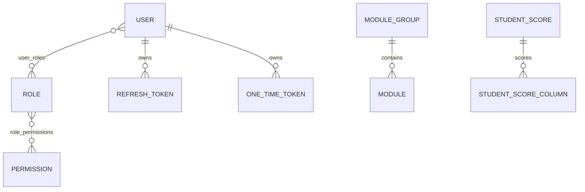
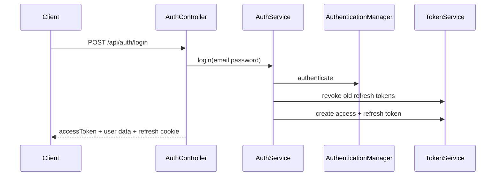

# Đặc tả và hướng dẫn đọc codebase Backend

> Phạm vi: thư mục `backend/`. Tài liệu này được viết bằng cách đối chiếu trực tiếp source code hiện tại.

## 1. Bức tranh tổng thể

Backend là ứng dụng **Spring Boot 3.3.3, Java 21**, cung cấp:

- đăng nhập email/mật khẩu và Google OAuth2;
- access token JWT, refresh token và one-time token;
- RBAC theo `User -> Role -> Permission`;
- generic CRUD dùng chung;
- tìm kiếm, filter động, phân trang và sort;
- import/export Excel, CSV, PDF;
- tự sinh permission/menu khi startup;
- email xác thực và reset password;
- các module demo Book, Student Score, Topic Mark.

Mô hình tư duy quan trọng nhất:

```text
HTTP request
  -> Spring Security / JWT filter
  -> Controller
  -> Service (permission + nghiệp vụ + transaction)
  -> Mapper
  -> Repository
  -> JPA Entity / Database
```

Phần lớn module CRUD không viết lại năm endpoint. Chúng kế thừa bộ khung `base/crud` rồi chỉ khai báo Entity, DTO, Filter, Mapper, Repository, Service và Controller riêng.

Ví dụ luồng tạo Book:

```text
BookController
  -> BaseCrudController.create(...)
  -> BookServiceImpl.create(...) kế thừa BaseCrudServiceImpl
  -> kiểm tra BOOK_CREATE
  -> BookMapper.toEntity(...)
  -> BookServiceImpl.beforeCreate(...) kiểm tra trùng tên
  -> BookRepository.save(...)
  -> BookMapper.toResponse(...)
```

## 2. Công nghệ chính

File dependency: `backend/pom.xml`.

| Công nghệ | Vai trò |
|---|---|
| Java 21, Spring Boot 3.3.3 | Runtime và application framework |
| Spring Web | REST API, controller, multipart |
| Spring Data JPA / Hibernate | Persistence, query, auditing |
| H2 | Database mặc định |
| Spring Security / OAuth2 Client | Authentication và authorization |
| Nimbus JWT | Ký/verify JWT bằng RSA |
| Spring Validation | Validate request DTO |
| MapStruct | Sinh code map Entity/DTO |
| Lombok | Giảm boilerplate |
| Thymeleaf + Spring Mail | Email và trang verification |
| Apache POI / OpenCSV / iText | Excel, CSV, PDF |
| Reflections | Quét class theo annotation |
| SpringDoc OpenAPI | Swagger UI |
| Actuator | Health endpoint |

Redis có dependency và Docker service nhưng source hiện chưa dùng Redis để lưu token/cache. Token được lưu qua JPA.

## 3. Cấu trúc thư mục

```text
backend/
├── pom.xml
├── mvnw, mvnw.cmd
└── src/
    ├── main/
    │   ├── java/com/example/starter_project_2025/
    │   │   ├── StarterProject2025Application.java
    │   │   ├── base/
    │   │   │   ├── crud/        # Generic CRUD, filter, mapper, validation
    │   │   │   └── dataio/      # Import, export và template
    │   │   ├── config/           # OpenAPI
    │   │   ├── exception/        # Exception + global handler
    │   │   ├── init/             # Seed permission, role, user, menu, data
    │   │   ├── security/         # Security chain, JWT, OAuth2, auditing
    │   │   └── system/
    │   │       ├── auth/
    │   │       ├── dashboard/
    │   │       ├── demo/         # Book, StudentScore
    │   │       ├── menu/         # Module, ModuleGroup
    │   │       ├── rbac/         # User, Role, Permission
    │   │       └── topic_mark/   # Gradebook demo
    │   └── resources/
    │       ├── application.properties
    │       └── templates/
    └── test/
```

`StarterProject2025Application` bật Spring Boot, scheduling và async support. Scheduling phục vụ job dọn token.

## 4. Cấu hình và chạy local

`application.properties` đang dùng:

- port `8080`;
- H2 in-memory `jdbc:h2:mem:base_crud`;
- `spring.jpa.hibernate.ddl-auto=create-drop`;
- H2 Console `/h2-console`;
- frontend `http://localhost:5173`;
- access token 3600 giây;
- refresh token 604800 giây;
- one-time token 900 giây.

Chạy:

```bash
cd backend
./mvnw spring-boot:run
```

```text
API:         http://localhost:8080
Swagger UI:  http://localhost:8080/swagger-ui/index.html
H2 Console:  http://localhost:8080/h2-console
Health:      http://localhost:8080/actuator/health
```

H2 `create-drop` làm dữ liệu mất sau mỗi lần chạy; initializer sẽ seed lại. `backend.env.example` có MySQL `DB_URL`, nhưng properties hiện chưa tham chiếu biến này nên tạo env file chưa đủ để chuyển qua MySQL.

`docker/dev-env.yml` có MySQL và Redis. `docker/Dockerfile` cùng `docker/docker-compose.yml` hiện rỗng, nên production container chưa hoàn thiện.

## 5. Generic CRUD (`base/crud`)

### 5.1 `BaseEntity`

Đây là `@MappedSuperclass` với các field:

| Field | Ý nghĩa |
|---|---|
| `id` | Khóa chính Long tự tăng |
| `isActive` | Trạng thái hoạt động, mặc định true |
| `createdAt`, `updatedAt` | Hibernate tự gán |
| `createdBy`, `updatedBy` | Spring Data auditing tự gán |

`isActive` không phải soft delete. `delete()` thực sự gọi repository `delete`.

`JpaAuditEnableConfig` bật auditing; `AuditorProvider` lấy ID từ `UserPrincipal` trong security context.

### 5.2 `BaseDTO` và validation group

DTO chung có ID, active state và audit fields. Audit fields là JSON read-only; `isActive` bắt buộc khi tạo.

- POST dùng `@Validated(OnCreate.class)`;
- PUT dùng `@Validated(OnUpdate.class)`.

Lưu ý: constraint không khai báo `groups` thuộc group `Default`. Khi controller chỉ yêu cầu `OnCreate`/`OnUpdate`, cần kiểm tra constraint mặc định có chạy đúng ý định hay không. Nên khai báo group rõ ràng hoặc thiết kế marker group kế thừa `Default`.

### 5.3 Repository

`BaseCrudRepository<E, I>` kế thừa `JpaRepository` và `JpaSpecificationExecutor`, vì vậy có cả CRUD lẫn query `Specification` động.

### 5.4 Mapper

`BaseCrudMapper<E, D>` có:

- `toEntity(D)`;
- `toResponse(E)`;
- `update(@MappingTarget E, D)`.

Update mặc định ignore property null, nên mang tính partial update. Mapper cụ thể xử lý quan hệ:

- `UserMapper`: `roles <-> roleIds`, không trả password;
- `RoleMapper`: `permissions <-> permissionIds`;
- `ModuleMapper`: `moduleGroup.id <-> moduleGroupId`.

`BaseMapperConfig` ignore target chưa map. Điều này giảm boilerplate nhưng có thể che giấu field mới bị bỏ sót; thêm field xong nên kiểm tra mapper generated/response.

### 5.5 Controller dùng chung

`BaseCrudController` cung cấp:

| Method | Path tương đối | Chức năng |
|---|---|---|
| GET | `` | List page/search/filter |
| GET | `/{id}` | Chi tiết |
| POST | `` | Tạo |
| PUT | `/{id}` | Cập nhật |
| DELETE | `/{id}` | Xóa vật lý |

`BaseCrudDataIoController` thêm:

| Method | Path | Chức năng |
|---|---|---|
| GET | `/export?format=EXCEL` | Export toàn bộ |
| POST | `/import` | Import multipart file |

Controller cụ thể rất mỏng: chỉ khai báo base path, service, repository và entity class.

### 5.6 Service template method

Create:

```text
check CREATE permission
 -> mapper.toEntity(dto)
 -> beforeCreate(entity, dto, ctx)
 -> ctx.throwIfErrors()
 -> repository.save(entity)
 -> afterCreate(entity, dto)
 -> mapper.toResponse(entity)
```

Update:

```text
check UPDATE permission
 -> findById hoặc 404
 -> beforeUpdate(existing, dto, ctx)
 -> ctx.throwIfErrors()
 -> mapper.update(existing, dto)
 -> repository.save(entity)
 -> afterUpdate(entity, dto)
 -> mapper.toResponse(entity)
```

Các hook mở rộng: `before/afterCreate`, `before/afterUpdate`, `before/afterDelete`, `searchableFields`.

`ValidationContext` gom nhiều business error theo field rồi mới ném `BusinessValidationException`.

## 6. Search, filter, page và sort

```http
GET /api/student-scores?page=0&size=10&sort=studentName,asc&search=an&className=SE-01
Authorization: Bearer <token>
```

- `search`: OR trên các field String từ `searchableFields()`;
- filter DTO: các predicate được `AutoSpecBuilder` ghép AND.

`@FilterField` hỗ trợ EQUAL, NOT_EQUAL, LIKE, so sánh, IN, BETWEEN, null test và relation path như `moduleGroup.id` qua LEFT JOIN.

`BaseFilter` có sẵn `ids`, `isActive`, created/updated range, createdBy, updatedBy. Kết quả là Spring `Page<D>`.

## 7. Mô hình dữ liệu



### RBAC

`User` có email unique, BCrypt password hash, tên, active state và many-to-many Role. `Role` many-to-many Permission. `Permission` có name unique, resource, action.

`UserPrincipal.fromUser()` tạo authorities:

```text
ROLE_ADMIN
ROLE_STUDENT
BOOK_READ
USER_CREATE
...
```

Generic CRUD kiểm tra permission trực tiếp (`BOOK_READ`), không kiểm tra `ROLE_*`.

### Menu

`ModuleGroup` one-to-many `Module`. Module lưu title, URL, icon, description, order và `requiredPermission` để frontend ẩn/hiện menu.

### StudentScore

Gồm student code, name, class, `Map<String, BigDecimal> scores`, overall score. Map được lưu bằng `@ElementCollection` trong bảng `student_score_columns`.

```json
{
  "isActive": true,
  "studentCode": "STU006",
  "studentName": "Nguyen Van B",
  "className": "SE-01",
  "scores": {"quiz1": 8.25, "assignment": 9.0, "final": 8.5}
}
```

Service bỏ key rỗng/value null, làm tròn hai chữ số và tính trung bình cộng.

## 8. Phân quyền CRUD

Entity gắn `@ResourcePermission("BOOK")`. `PermissionInitializer` đọc JPA metamodel và sinh:

```text
BOOK_CREATE
BOOK_READ
BOOK_UPDATE
BOOK_DELETE
```

`BaseCrudServiceImpl` lấy annotation, ghép action, đọc authorities từ `SecurityContextHolder`; thiếu quyền thì trả 403.

Ví dụ có `BOOK_READ` chỉ được GET Book, không được POST nếu thiếu `BOOK_CREATE`.

Quan trọng: import/export truy cập repository trực tiếp, nên hiện chỉ yêu cầu authenticated ở security chain, chưa gọi check `*_READ`/`*_CREATE` như service CRUD.

## 9. Authentication và token

### Security chain

`SecurityConfig` tắt CSRF, bật CORS credential, permit auth/verify/OAuth2/Swagger/H2/health, yêu cầu authenticated cho phần còn lại, và đặt JWT filter trước username/password filter.

Session policy là `IF_REQUIRED`, không phải STATELESS, để OAuth2 flow có thể dùng session.

### Login



Raw refresh token chỉ nằm trong HttpOnly cookie; DB lưu SHA-256 hash. Access JWT ký RSA và có email, name, roles, permissions, rolePermissions, issuedAt, expiresAt.

### JWT request

`JwtAuthenticationFilter` đọc `Authorization: Bearer ...`, verify JWT, lấy subject email, tải lại User từ DB và tạo Authentication với authorities hiện tại. Vì tải lại DB, đổi role/permission có hiệu lực ở request sau dù claim JWT cũ chưa đổi.

JWT lỗi/user không tồn tại thì filter xóa context; protected endpoint trả 401.

### Refresh/logout

`POST /api/auth/refresh` đọc cookie, hash token, kiểm tra revoked/expiry, revoke token cũ, sinh access + refresh mới và cập nhật cookie. Đây là refresh-token rotation.

Login mới revoke mọi refresh token cũ của user. Logout revoke token hiện tại và xóa cookie.

### Register/verify/reset password

```text
register
 -> kiểm tra email
 -> BCrypt password
 -> user inactive + STUDENT role
 -> lưu
 -> tạo EMAIL_VERIFY token
 -> gửi email
```

`GET /verify?token=...` verify token, mark used, active user và render Thymeleaf page.

Forgot password tạo `RESET_PASSWORD` token. Reset password verify token, BCrypt mật khẩu mới, revoke toàn bộ refresh token và mark token used.

### Google OAuth2

Success handler đọc `email/given_name/family_name`. User mới được tạo active với STUDENT role; user cũ được bổ sung thông tin cần thiết. Backend phát token, set refresh cookie và redirect `${frontendUrl}/oauth2/redirect?token=...`.

### Token cleanup và RSA

`TokenCleanupJob` chạy 03:00 mỗi ngày để xóa refresh/one-time token hết hạn hoặc đã dùng.

RSA key pair hiện sinh ngẫu nhiên mỗi lần khởi động trong `RSAKeyProperties`, nên access token phát trước restart không còn verify được sau restart.

## 10. Startup initializer

| Order | Class | Công việc |
|---:|---|---|
| 1 | `PermissionInitializer` | Sinh CRUD permission |
| 2 | `RoleDataInitializer` | Upsert ADMIN/STUDENT/TEACHER |
| 3 | `UserDataInitializer` | Seed user demo |
| 10 | `AutoMenuInitializer` | Quét `@ResourceMenu`, upsert menu |
| 11 | `StudentScoreDataInitializer` | Seed điểm demo |

Role mặc định:

- ADMIN: toàn bộ permissions;
- STUDENT: `MENU_READ`, `BOOK_READ`;
- TEACHER: `MENU_READ` và CRUD Book.

User dev:

| Email | Password | Role |
|---|---|---|
| `admin@example.com` | `password123` | ADMIN |
| `student@example.com` | `password123` | STUDENT |
| `teacher@example.com` | `password123` | TEACHER |

`@ResourceMenu` khai báo title, group, icon, URL, order, permission. `AutoMenuInitializer` scan `com.example`, chuẩn hóa URL/permission, tạo group nếu thiếu và upsert Module. Đây là metadata menu cho frontend.

## 11. Import/export

### Export

Entity gắn `@ExportEntity`, field gắn `@ExportField`.

```text
GET /api/books/export?format=EXCEL
 -> repository.findAll()
 -> GenericExportService
 -> ExportConfigBuilder đọc metadata
 -> Excel/Csv/PdfExporter
 -> ghi HttpServletResponse
```

Relation có thể export theo path, ví dụ User.roles lấy `name`. Format: EXCEL, CSV, PDF.

### Import

Entity gắn `@ImportEntity("book")`, field gắn `@ImportField`.

```text
multipart file
 -> ParserFactory chọn CSV/XLSX
 -> Map<header,string> cho từng dòng
 -> GenericImportMapper tạo entity
 -> ValueConverter đổi kiểu
 -> RelationLookupEngine resolve relation
 -> @PostImport hook
 -> @ImportHash hash password
 -> repository.save
```

Mỗi dòng độc lập; kết quả có success/failure count và lỗi theo số dòng. Relation lookup dựa trên quy ước bean repository và method như `roleRepository.findByName(String)`.

Import gọi repository trực tiếp nên không chạy DTO validation, `beforeCreate` business rule hay permission check của service.

### Template

```http
GET /api/import/template?entity=book
GET /api/import/template?entity=user
GET /api/import/template?entity=student-score
```

Registry scan `@ImportEntity`; template XLSX lấy header từ `@ImportField`.

## 12. API chính

### Generic CRUD resources

Mỗi path có list/detail/create/update/delete/export/import:

| Base path | Resource | Permission prefix |
|---|---|---|
| `/api/users` | User | USER |
| `/api/roles` | Role | ROLE |
| `/api/permissions` | Permission | PERMISSION |
| `/api/module-groups` | ModuleGroup | MENU |
| `/api/modules` | Module | MENU |
| `/api/books` | Book | BOOK |
| `/api/student-scores` | StudentScore | STUDENT_SCORE |

Module và ModuleGroup dùng chung `MENU_*`.

### Auth

| Method | Endpoint | Ý nghĩa |
|---|---|---|
| POST | `/api/auth/login` | Login |
| POST | `/api/auth/register` | Register |
| POST | `/api/auth/refresh` | Rotate token |
| POST | `/api/auth/logout` | Logout |
| POST | `/api/auth/forgot-password` | Gửi reset mail |
| POST | `/api/auth/resend-verification` | Gửi lại verify |
| PATCH | `/api/auth/reset-password` | Reset password |
| GET | `/verify?token=...` | Verify email |

### Khác

| Method | Endpoint | Ý nghĩa |
|---|---|---|
| GET | `/api/dashboard/stats` | Dashboard stats |
| GET | `/api/import/template` | Import template |
| GET | `/api/topic-marks/gradebook` | Gradebook |
| GET | `/api/topic-marks/gradebook/search` | Search/page/sort |
| GET | `/api/topic-marks/students/{userId}` | Chi tiết điểm |
| PUT | `/api/topic-marks/students/{userId}` | Cập nhật điểm |
| GET | `/api/topic-marks/history` | Lịch sử điểm |

## 13. Nghiệp vụ từng module

### User

Kiểm tra email unique, role IDs tồn tại, BCrypt password; update roles khi request có `roleIds`. Response không có password. Search email/firstName/lastName.

### Role

Name unique; create cần ít nhất một permission; toàn bộ permission ID phải tồn tại. Search name/description, filter permission IDs.

### Permission

Name unique. Search name/description/resource/action; filter resource/action.

### ModuleGroup/Module

Group name unique không phân biệt hoa thường. Module kiểm tra group tồn tại, URL unique và title unique trong group.

### Book

Name unique, description tùy chọn, search name/description. Đây là module dễ nhất để học generic CRUD.

### Dashboard

Trả tổng/active user, role, menu. Chỉ yêu cầu authenticated ở filter chain, chưa có permission riêng trong service.

### Topic Mark demo

Đây là prototype trên `StudentScore`, chưa phải domain gradebook chuẩn hóa:

- đọc toàn bộ score key để tạo column động;
- `quiz1` thành label `Quiz 1`;
- component UUID được suy ra từ tên;
- student UUID suy ra từ studentCode, không liên kết User;
- thêm `FINAL_SCORE`, `IS_PASSED`;
- search/page/sort trong memory sau `findAll()`;
- history ở `CopyOnWriteArrayList`, mất khi restart;
- component hiển thị weight bằng nhau;
- final score là trung bình cộng.

Phù hợp prototype API/frontend contract, chưa phù hợp production data lớn.

## 14. Xử lý lỗi

`GlobalExceptionHandler` map:

| Exception | Status |
|---|---:|
| ResourceNotFound | 404 |
| BadRequest / validation | 400 |
| BadCredentials | 401 |
| AccessDenied | 403 |
| Exception chưa biết | 500 |

Validation response:

```json
{
  "message": "Validation failed",
  "errors": {
    "email": ["Email is already in use"],
    "roleIds": ["One or more roles are invalid"]
  }
}
```

401/403 từ security filter có shape `code + message`, khác `status + message + timestamp` của controller advice. Client cần chấp nhận hai shape hoặc backend nên chuẩn hóa.

## 15. Cách thêm CRUD module mới

Ví dụ `Course`:

1. Tạo entity kế thừa `BaseEntity`, gắn `@ResourcePermission("COURSE")`.
2. Nếu cần menu, gắn `@ResourceMenu(... permission="COURSE_READ")`.
3. Nếu cần I/O, gắn `@ImportEntity`, `@ExportEntity`, annotation trên field.
4. DTO kế thừa `BaseDTO`; Filter kế thừa `BaseFilter`.
5. Mapper kế thừa `BaseCrudMapper` và map relation IDs rõ ràng.
6. Repository kế thừa `BaseCrudRepository<Course, Long>`.
7. Service interface kế thừa `BaseCrudService`; implementation kế thừa `BaseCrudServiceImpl`.
8. Khai báo repository, mapper, searchable fields và business hooks.
9. Controller kế thừa `BaseCrudDataIoController` với `/api/courses`.
10. Restart: permissions/menu sẽ được initializer tạo.
11. Thêm test validation, permission, mapper, filter và import/export.

Skeleton entity:

```java
@Entity
@ResourcePermission("COURSE")
@ResourceMenu(
    title = "Courses",
    group = "Training",
    url = "/courses",
    permission = "COURSE_READ"
)
public class Course extends BaseEntity {
    @Column(unique = true, nullable = false)
    private String code;
}
```

## 16. Test hiện có

- `StarterProject2025ApplicationTests`: load context;
- `ModuleGroupServiceTest`: cấu hình và unique-name hooks;
- `ModuleGroupControllerTest`: MockMvc CRUD/import/export, tắt security filter.

```bash
cd backend
./mvnw test
```

Coverage còn mỏng ở JWT/refresh rotation, OAuth2, permission denial, import relation, exporter, initializer, User/Role và Topic Mark.

## 17. Các điểm cần lưu ý

1. Runtime dùng H2 nhưng env/Docker chuẩn bị MySQL, chưa được nối cấu hình.
2. H2 `create-drop` làm dữ liệu không bền.
3. RSA key sinh lại khi restart, làm access token cũ vô hiệu.
4. Mail/default credential xuất hiện trong cấu hình mẫu; production cần env/secret manager.
5. Import/export bypass permission check của CRUD service.
6. Import bypass DTO/business validation hooks.
7. `UserFilter` dùng path `userRoles.role.id` trong khi entity có field `roles`; filter role có thể lỗi JPA path.
8. `DashboardService` inject `ModuleRepository` hai lần nên `totalMenus` và `totalMenuItems` cùng đếm Module thay vì dùng ModuleGroupRepository cho một giá trị.
9. Topic Mark là demo: history in-memory, pagination in-memory, không có permission service-level.
10. CSV exporter chưa escape đầy đủ comma/quote/newline.
11. Validation group cần rà soát để constraint Default chạy đúng ý định.
12. Response schema lỗi giữa security và controller chưa thống nhất.
13. Refresh cookie có HttpOnly và tùy chọn Secure, chưa cấu hình SameSite rõ ràng.
14. Dockerfile và production compose đang rỗng.

## 18. Thứ tự đọc source đề xuất

1. `system/demo/book/Book.java`, DTO, Controller;
2. `base/crud/controller/BaseCrudController.java`;
3. `base/crud/service/BaseCrudServiceImpl.java`;
4. `BookServiceImpl.java`, `BookMapper.java`;
5. `security/SecurityConfig.java`, `JwtAuthenticationFilter.java`;
6. `security/UserPrincipal.java` và ba entity RBAC;
7. `system/auth/authentication/AuthServiceImpl.java`;
8. `RefreshTokenServiceImpl.java`;
9. các class trong `init/`;
10. `GenericImportService`, `GenericExportService`;
11. `StudentScoreServiceImpl`;
12. `TopicMarkDemoService`.

Sau chuỗi này, có thể thấy codebase là một generic CRUD engine được bao quanh bởi JWT/RBAC, initializer và annotation-driven data I/O.

## 19. Checklist debug request

1. Endpoint public hay protected? Bearer token đã có chưa?
2. JWT còn hạn và được ký bằng key của lần chạy hiện tại không?
3. User còn active và tồn tại không?
4. User có đúng `RESOURCE_ACTION` authority không?
5. DTO có bị validation group chặn không?
6. Business hook có thêm lỗi vào `ValidationContext` không?
7. Mapper có bỏ sót field/ghi đè relation không?
8. Filter path có đúng tên field entity không?
9. Lazy relation có được load trong transaction không?
10. Lỗi phát sinh ở filter chain hay controller advice?

Đây là cách lần nhanh từ triệu chứng HTTP về đúng tầng code cần kiểm tra.
