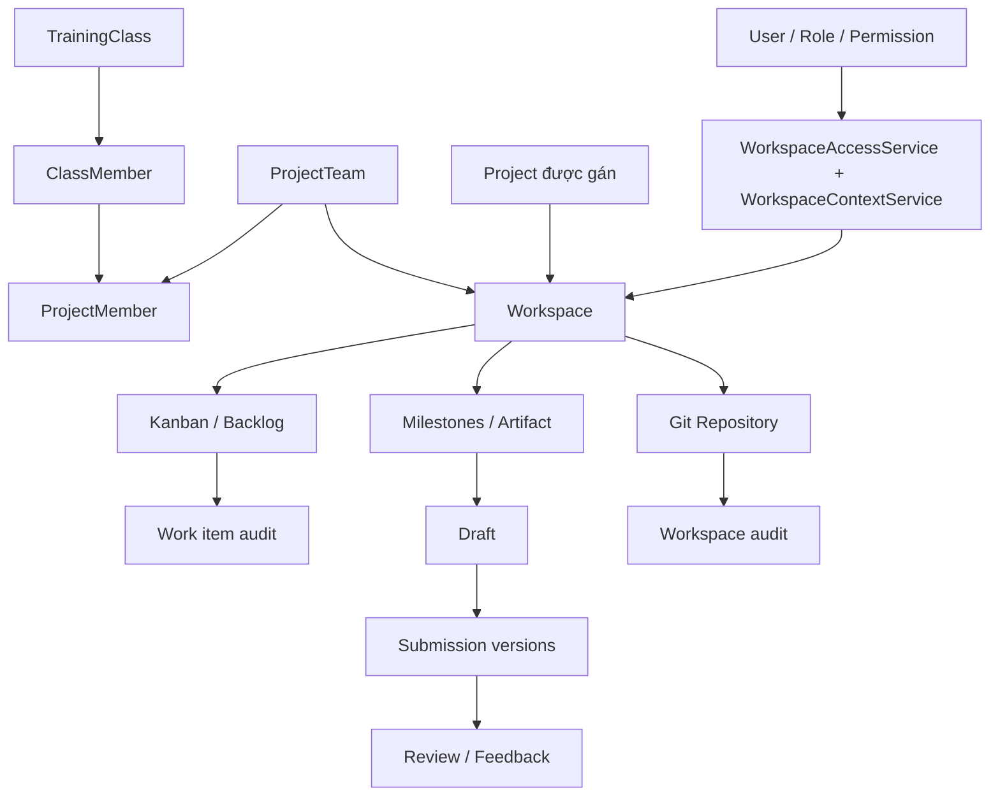
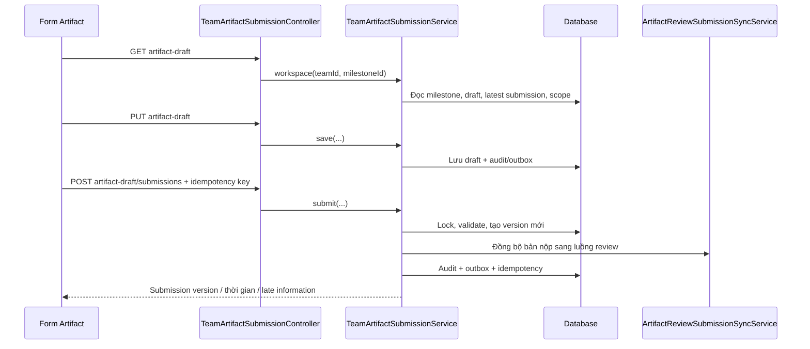
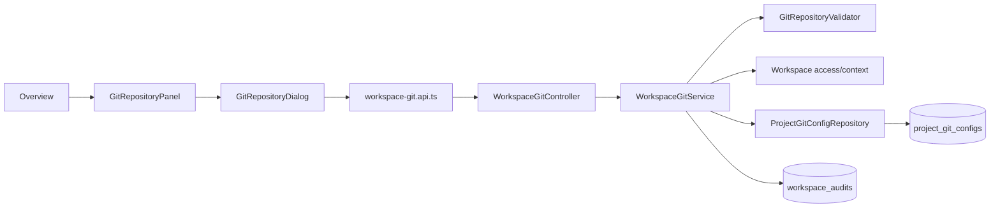

# Bản đồ code Sprint 1–3 — Trần Trọng Hòa

Ngày đối chiếu: 06/11/2026. Nhánh: `feature/workspace-git-repository`.
PR tích hợp: https://github.com/hcm26-cpl-java-10-class/HCM26_CPL_JAVA_10/pull/244
Mốc nhánh nhóm đã tích hợp: `23fcc734` (`feature/project`).

## 1. Phạm vi chức năng và cách đọc tài liệu

| Giai đoạn | Phần được giao/phần đã phát triển trong phiên làm việc | Kết quả người dùng nhìn thấy |
|---|---|---|
| Sprint 1 | UFR-PRJ-005: Board, Task List, lịch sử trạng thái | Xem/cập nhật công việc, xem người phụ trách và lịch sử |
| Sprint 2 | UFR-PRJ-006: chuẩn bị artifact, lưu nháp, nộp, nộp lại thành version mới; tích hợp Workspace | Tab Artifact, form nộp, lịch sử phiên bản, feedback và thao tác nộp lại |
| Sprint 3 | UFR-PRJ-010-US01A / UFR-PRJ-011-US02A: cấu hình và truy cập Git repository | Git Repository trong Overview: xem, mở, copy clone URL, thêm/sửa/hủy liên kết theo quyền |
| Hoàn thiện tích hợp | UI Board/Artifact, đồng bộ assignee, giới hạn nhập, tương thích dữ liệu H2 cũ, kiểm thử hồi quy | Giao diện gọn hơn, trạng thái và dữ liệu đồng nhất giữa các màn hình |

Đây là bản đồ chức năng hiện có và các điểm tích hợp, không phải tuyên bố mọi file bên dưới đều do một người viết. Workspace, lớp/nhóm, milestone lifecycle, rubric, review và resources có code do nhóm tích hợp. Muốn xác định tác giả một dòng cụ thể phải dùng `git blame` và đọc commit tương ứng.

PR #244 chỉ chứa phần chênh lệch so với nhánh nhóm. Những chức năng đã merge từ các PR trước vẫn tồn tại trong code nhưng không xuất hiện lại trong danh sách file thay đổi của PR này.

## 2. Cấu trúc và quan hệ chung

Frontend dùng React/TypeScript, TanStack Query, các component UI dùng chung và Tailwind. Backend dùng Spring Boot, Spring Security, JPA/Hibernate. Component gọi API; controller nhận request; service kiểm tra quyền/phạm vi và nghiệp vụ; repository đọc/ghi entity; response quay về và query cache được cập nhật.

Project có thể chưa được gán khi Workspace là Team-only. Không coi `projectId = null` là lỗi mặc định. Phạm vi Master/Sub-project đi qua mô hình Project và các assignment mà nhóm đã tích hợp; không tự tạo thêm mô hình project cha–con trong tính năng Git.

## 3. Sprint 1 và phần Board trong Workspace

### 3.1. Ba loại dữ liệu công việc cần phân biệt

| Loại | Entity / bảng | Màn hình sử dụng | Lịch sử |
|---|---|---|---|
| Task của Project Board | `system/project/sprint/Task.java` → `sprint_task` | `ProjectBoardPage`, `ProjectTaskListView` | `project_activity_log`, lọc sự kiện đổi trạng thái |
| Work item của Workspace | `sprint_backlog/SprintBacklog.java` → `sprint_backlog` | `WorkspaceTeamBoardPanel`, backlog trong Workspace | `sprint_backlog_audit_log` |
| Subtask | `system/project/task/Task.java` → `task` | `BacklogSubtasksPanel` | API workflow/activity của subtask |

Hai class cùng tên `Task` nằm ở hai package khác nhau. Không dùng ID UUID của subtask để gọi API Project Task ID số; không lấy lịch sử `sprint_task` để hiển thị lịch sử work item `sprint_backlog`.

### 3.2. Frontend

Đường dẫn FE dưới đây tính từ `frontend/src/`.

| File | Công dụng | Liên kết chính |
|---|---|---|
| `pages/project/ProjectBoardPage.tsx` | Board Project/Sprint, các cột và thao tác task | `project-board.api.ts` |
| `pages/project/ProjectTaskListView.tsx` | Danh sách Project Task, tìm/lọc/sort/phân trang, cập nhật và lịch sử | API Project Task và status-history |
| `api/features/project-board.api.ts` | Hợp đồng gọi Board, task, assignee, trạng thái và lịch sử Project | `ProjectBoardController`, `ProjectTaskController` |
| `pages/management/workspace/WorkspaceTeamBoardPanel.tsx` | Kanban/List của Workspace, chọn sprint, lọc, assignee, kéo thả, detail, lịch sử từng dòng và Activity Trail | `team-backlog.api.ts`, API sprint-backlogs, `BacklogItemDetailSheet` |
| `api/features/team-backlog.api.ts` | Đọc board theo Team/Workspace/Project và cập nhật assignee | `TeamBacklogController` |
| `pages/management/backlog/components/BacklogItemDetailSheet.tsx` | Drawer chi tiết và sửa work item; giới hạn mô tả, vùng cuộn | API sprint-backlogs, subtask, assignee options |
| `pages/management/backlog/components/BacklogSubtasksPanel.tsx` | Danh sách/tạo/sửa subtask của work item | API task/workflow của nhóm |
| `lib/refresh-backlog-item.ts` | Cập nhật detail và cache board sau khi lưu, rồi invalidate danh sách/audit liên quan | Dùng ID `ProjectMember` để đối chiếu tên assignee |
| `pages/management/backlog/components/SprintCreateRow.tsx` | Dòng tạo work item trong backlog/sprint | Giới hạn mô tả 1.000 ký tự |
| `pages/management/sprint-backlog/index.tsx` | Schema trang quản lý Sprint Backlog chung | Validation FE khớp giới hạn BE |

### 3.3. Backend

Đường dẫn BE dưới đây tính từ `backend/src/main/java/com/example/starter_project_2025/system/project/`.

| File | Công dụng / quan hệ |
|---|---|
| `board/ProjectBoardController.java`, `ProjectBoardOptionsController.java` | API đọc Board và các lựa chọn Project/Sprint |
| `board/ProjectBoardServiceImpl.java` | Kiểm tra phạm vi Project/Sprint, đọc task và hoạt động gần đây; thao tác xem không tạo dữ liệu |
| `task/ProjectTaskController.java` | `/api/projects/{projectId}/tasks`, thay đổi status/assignee/sprint/order và `status-history` |
| `task/ProjectTaskServiceImpl.java` | Validate, kiểm tra version, cập nhật `sprint_task`, ghi activity và outbox |
| `task/TaskStatusWorkflow.java` | Ma trận bốn trạng thái liền kề của Project Task |
| `team/TeamBacklogController.java`, `TeamBacklogService.java` | `/api/teams/{teamId}/backlog-board`; lấy sprint/work item đúng scope và các thành viên được chọn |
| `sprint_backlog/SprintBacklogController.java` | CRUD work item, assignee options, `/{id}/audit-logs` |
| `sprint_backlog/SprintBacklogServiceImpl.java` | Kiểm tra dữ liệu, assignee, project/sprint/milestone và thứ tự chuyển trạng thái; gọi audit/outbox |
| `sprint_backlog/SprintBacklogMapper.java`, `SprintBacklogDTO.java` | Chuyển entity thành hợp đồng FE, gồm ID/tên assignee |
| `sprint_backlog/audit/SprintBacklogAuditService.java`, `SprintBacklogAuditLog.java`, repository/DTO | Lưu/trả actor, thời gian, before/after và correlation ID |
| `activity/ProjectActivityLog.java`, `ProjectActivityRepository.java` | Activity và status-history cho Project Board |
| `task/event/TaskOutboxService.java`, `BoardTaskOutboxEvent.java` | Ghi sự kiện của Board Task để xử lý sau transaction |
| `ProjectMemberEligibility.java`, `ProjectMemberRepository.java` | Xác định thành viên hợp lệ cho việc phân công |

Quy tắc hiện hành cho work item đã ở Sprint: `TODO ↔ IN_PROGRESS ↔ REVIEW ↔ DONE`. Không nhảy qua cột. Bốn trạng thái cố định; yêu cầu thêm/xóa/đổi tên workflow trước đây đã được thay thế bởi yêu cầu của nhóm trưởng. Product Backlog là việc chưa có `sprint_id`, không phải trạng thái thứ năm của Workspace Board.

Assignee đi qua `project_members.id → class_members.member_id → users.id`. ID người dùng, ID thành viên lớp và ID thành viên nhóm không thể dùng thay nhau. Tên trên card và detail phải được đối chiếu từ cùng ID thành viên nhóm và cập nhật cache sau khi lưu.

## 4. Sprint 2 — Draft / Submit / Resubmit / History

### 4.1. Luồng chính

### 4.2. File Frontend

| File dưới `frontend/src/` | Công dụng |
|---|---|
| `pages/management/workspace/WorkspaceArtifactsPanel.tsx` | Bảng Artifact, search, lọc milestone/status, phân trang client, tổng quan, history dialog và nút submit/resubmit theo quyền |
| `pages/management/workspace/workspace-artifacts.utils.ts` | Chuẩn hóa và ánh xạ review status/nhãn/màu cho bảng |
| `pages/student/TeamArtifactSubmissionPage.tsx` | Form nộp theo Team: nạp draft, URL/release notes, preview, save/submit và hiển thị kết quả |
| `pages/student/ArtifactDraftPage.tsx` | Form chuẩn bị artifact theo Project |
| `pages/student/StudentTeamMilestoneSubmissionsPage.tsx` | Xem bài nộp của mình theo milestone, draft, các version và feedback/nộp lại |
| `pages/student/milestone-submission/StudentSubmissionListPage.tsx` | Danh sách bài nộp của Student |
| `pages/student/milestone-submission/StudentSubmissionPage.tsx` | Chi tiết bài nộp thuộc luồng review/version; giới hạn summary theo BE |
| `api/features/milestone.api.ts` | Gọi milestone, artifact-draft, submit và các API lịch sử |
| `lib/artifact-form-source.ts` | Tiện ích chọn dữ liệu nguồn cho form artifact |

Các trang review như `SubmissionReviewPage.tsx` và `SubmissionReviewForm.tsx` là phần liên quan của nhóm, dùng để nhận xét/chấm/accept/reject/request changes; không đồng nhất với hành động nộp của Student.

### 4.3. File Backend và lưu trữ

Đường dẫn tương đối dưới `system/project/milestone/submission/`.

| File | Vai trò |
|---|---|
| `controller/TeamArtifactSubmissionController.java` | API Team draft/save/submit, `my-submissions`, danh sách submissions |
| `controller/ArtifactSubmissionController.java` | API Project draft/save/submit và upload khi policy cho phép |
| `service/TeamArtifactSubmissionService.java` | Nghiệp vụ Team: scope, draft, tạo artifact version, trả lịch sử/feedback |
| `service/ArtifactDraftService.java` | Nghiệp vụ draft theo Project |
| `service/ArtifactSubmissionService.java` | Nghiệp vụ submit theo Project; lock, validation, version, idempotency, audit/outbox |
| `service/ArtifactReviewSubmissionSyncService.java` | Cầu nối artifact store với submission/version bên reviewer |
| `service/MilestoneSubmissionWindow.java` | Kiểm tra lifecycle và hạn/late window để cho phép nộp |
| `service/ReleaseNotesWordLimit.java` | Release notes tối đa 1.000 từ, khác với summary/mô tả 1.000 ký tự |
| `dto/SubmissionDtos.java` | Request/response của luồng submission/review; summary tối đa 1.000 ký tự |
| `domain/MilestoneArtifactDraft.java`, repository | Nháp có thể sửa, bảng `milestone_artifact_drafts` |
| `domain/MilestoneArtifactSubmission.java`, repository | Nội dung version chính thức, bảng `milestone_artifact_submissions` |
| `domain/MilestoneSubmission.java` | Aggregate phía review, bảng `milestone_submissions` |
| `domain/SubmissionVersion.java` | Snapshot theo lần nộp của phía review, bảng `milestone_submission_versions` |
| `domain/SubmissionArtifact.java`, `SubmissionChecklistSnapshot.java` | Artifact/checklist theo review version; bảng `milestone_submission_artifacts`, `submission_checklist_snapshots` |
| `domain/MilestoneReview.java`, `ReviewCriterionEvaluation.java` | Review/đánh giá rubric; bảng `milestone_submission_reviews`, `milestone_review_criteria` |
| `service/SubmissionQueryService.java`, `SubmissionVersionService.java`, `SubmissionReviewService.java` | Đọc version, tạo version và xử lý review của module chung |
| `integration/JpaArtifactSubmissionScopeAdapter.java` | Adapter kiểm tra phạm vi dữ liệu thực tế |
| `mock/MockArtifactSubmissionScopeAdapter.java` | Adapter thay thế cho profile mock; không coi đây là mô hình production |

Các dependency ngoài thư mục submission: `milestone/domain/Milestone.java`, repository milestone, `milestone/audit`, `milestone/outbox`, `milestone/idempotency` và actor/scope provider.

### 4.4. Quy tắc giải thích khi demo

- `DRAFT` chưa phải nộp chính thức. Lưu xong có thể đi tới lịch sử và mở lại để sửa.
- `SUBMITTED` nghĩa là đã tiếp nhận; bảng hiển thị `Awaiting review`.
- `CHANGES_REQUESTED` cho phép đi luồng sửa/nộp lại nếu còn trong thời gian cho phép; tạo version mới và giữ version trước.
- `ACCEPTED` / `REJECTED` là kết quả review. Không tự mở resubmit chỉ vì đã nộp một lần.
- Thời điểm hiện tại vượt deadline chỉ cho phép ghi `Deadline passed`; `Submitted late` phải lấy từ dữ liệu lần nộp.
- Late window lấy `lateUntil` khi policy là `ALLOW_LATE`; nút resubmit có thể dẫn đến form nhưng backend vẫn kiểm tra hạn khi xác nhận nộp.
- Bảng đang dùng toàn bộ danh sách đã tải để search/filter rồi mới phân trang client. Khi history tải lỗi, trạng thái phải là chưa xác minh thay vì giả định chưa nộp.
- URL artifact được kiểm tra định dạng; đây không phải thao tác xác minh repository hoặc deployment đang truy cập được.

## 5. Sprint 3 — Cấu hình và xem Git Repository

### 5.1. Các file chính

| File | Công dụng / liên kết |
|---|---|
| FE `WorkspaceOverviewSection.tsx` | Điểm đặt phần Git Repository trong Overview; giữ nội dung khi background refetch |
| FE `WorkspaceGitRepositoryPanel.tsx` | Đọc trạng thái cấu hình/quyền, empty state, mở repository, copy, mở edit/unlink |
| FE `WorkspaceGitRepositoryDialog.tsx` | Form mới của nhóm: chọn provider/HTTPS/SSH, nhập clone URL/default branch, lỗi theo field và phần nâng cao Self-hosted SSH |
| FE `api/features/workspace-git.api.ts` | Kiểu dữ liệu và GET/PUT/DELETE `/workspaces/{id}/git-config` |
| BE `workspace/git/WorkspaceGitController.java` | Nhận request, áp dụng quyền đọc và trả lỗi 403/409/422 có correlation ID |
| BE `workspace/git/WorkspaceGitService.java` | Kiểm tra Workspace scope/quyền sửa, lock/version, lưu/hủy và audit cùng transaction |
| BE `workspace/git/GitRepositoryValidator.java` | Kiểm tra HTTPS/SSH clone URL, branch, thông tin đăng nhập và tạo URL trang repo cho provider hỗ trợ |
| BE `workspace/git/GitConfigDtos.java` | Hợp đồng save/view/error; `canEdit`, `canUnlink`, `configured`, version và metadata |
| BE `workspace/git/GitConfigValidationException.java` | Lỗi validation theo field để FE tô đúng ô nhập |
| BE `workspace/git/ProjectGitConfig.java` | Entity cấu hình Git theo Workspace |
| BE `workspace/git/ProjectGitConfigRepository.java` | Đọc/ghi bảng `project_git_configs` |
| BE `workspace/service/WorkspaceAccessService.java`, `WorkspaceContextService.java` | Kiểm tra actor, tenant, quyền và đối tượng Workspace |
| BE `workspace/domain/WorkspaceAudit.java`, repository | Audit thêm/sửa/hủy repo, before/after, actor và thời điểm |

### 5.2. Dữ liệu và bảo mật

`project_git_configs.workspace_id` vừa là khóa chính vừa liên kết `workspaces.id`: một cấu hình hiện hành cho mỗi Workspace. Bản ghi gồm tenant/team, clone URL, web URL, provider, default branch, version, actor và thời gian tạo/cập nhật.

`configured` được suy ra từ cấu hình; không phải lifecycle tương tự milestone. Hủy liên kết giữ revision để kiểm tra xung đột. Version gửi từ client phải khớp; cập nhật đồng thời không được âm thầm ghi đè.

Admin/Super Admin có quyền truy cập Workspace, Mentor được gán, thành viên có vai trò PM hoặc quyền Edit Workspace phù hợp được sửa theo logic hiện tại. Thành viên thường có quyền đọc xem được link/empty state nhưng không tự có quyền thay đổi. Backend kiểm tra lại, không chỉ ẩn nút trên FE.

Git URL lưu ở Workspace không tự sửa URL snapshot trong bản nộp cũ. Khi đổi Repo A sang B, nội dung Artifact đã nộp vẫn giữ nguyên. Tính năng không lưu PAT/password/private key; URL chứa credential phải bị từ chối. `Open repository` dùng link web an toàn mở tab mới. Default branch là cấu hình nhập tay, không có thao tác fetch danh sách branch từ Git.

Giao diện form mới có trong commit `de00cc05` (`NThanhLiem`, 05/11/2026, `feat(workspace): update workspace UI`). Khi rebase đã giữ file dialog của nhóm, gồm phần nâng cao Self-hosted SSH. Đây là lý do form hiện khác form tiếng Anh cũ; không phải UI mới được tạo trong các commit Board/Artifact của PR #244.

## 6. Bản đồ database liên quan

Các mũi tên dưới đây gồm cả khóa ngoại JPA và ID được service kiểm tra. Không phải mọi cột ID đều có FK vật lý.

| Bảng / entity | Quan hệ nghiệp vụ |
|---|---|
| `users`, `roles`, `permissions` và bảng nối | Authentication/RBAC; user thuộc tenant |
| `training_classes` | Thuộc tenant; lớp chứa class members và team allocation |
| `class_members` | `class_id → training_classes`, `user_id → users` |
| `project_teams` | `class_id → training_classes`, `allocation_session_id → team_allocation_sessions`, project được gán, mentor ID |
| `project_members` | `team_id → project_teams`, `member_id → class_members`; vai trò trong nhóm |
| `workspaces` | `team_id → project_teams`, `project_id → projects` có thể null, `tenant_id → tenants` |
| `workspace_sections` | Các tab của Workspace; enum hiện có Resources |
| `project_git_configs` | PK/FK workspace; scope tenant/team, URL/branch và revision |
| `workspace_audits` | Audit theo workspace/project/team/actor, before/after và correlation |
| `sprints` | Sprint theo Project/Team theo mô hình của nhóm |
| `sprint_task` | Task Board Project, Project/Sprint/assignee/version |
| `project_activity_log`, `board_task_outbox_event` | Lịch sử/sự kiện của Project Board |
| `sprint_backlog` | Work item; sprint có thể null, project/milestone/assignee/reporter |
| `sprint_backlog_audit_log` | Before/after và actor của work item |
| `task` | Subtask có `backlog_item_id → sprint_backlog` |
| `milestones` | Milestone thuộc phạm vi Project/Team, lifecycle, deadline, rubric/checklist, late policy |
| `milestone_artifact_drafts` | Draft của milestone, URL/release notes/checklist, actor/version |
| `milestone_artifact_submissions` | Artifact snapshot theo version/lần nộp, late flag/penalty |
| `milestone_submissions`, `milestone_submission_versions` | Aggregate và version phía review |
| `milestone_submission_artifacts`, `submission_checklist_snapshots` | Dữ liệu artifact/checklist bất biến theo review version |
| `milestone_submission_reviews`, `milestone_review_criteria` | Feedback/kết quả review và chấm theo rubric |
| `milestone_idempotency_records` | Dedupe cùng request, tránh sinh thêm version khi retry |

## 7. Chính xác những file khác nhánh nhóm trong PR #244

Danh sách được lấy từ `git diff origin/feature/project...HEAD` tại mốc nhóm `23fcc734`.

### Frontend: 10 file

| File | Thay đổi trong PR |
|---|---|
| `BacklogItemDetailSheet.tsx` | Mô tả 1.000 ký tự, vùng nhập có chiều cao/cuộn, bố cục detail; đồng bộ record mới trước khi hiển thị thay cho setState trong effect |
| `SprintCreateRow.tsx` | Chặn mô tả vượt 1.000 ký tự ở dòng tạo work item |
| `management/sprint-backlog/index.tsx` | Schema, thông báo và kiểm tra mô tả 1.000 ký tự |
| `WorkspaceArtifactsPanel.tsx` | Bảng compact/responsive, filter, trạng thái, version/history và thao tác theo quyền |
| `workspace-artifacts.utils.ts` | Tập trung ánh xạ review status |
| `WorkspaceTeamBoardPanel.tsx` | Board/List compact, card, toolbar, lịch sử từng dòng, filter và Activity Trail; tính Sprint được chọn từ dữ liệu hiện có, reset history/pagination theo context |
| `WorkspaceGitRepositoryPanel.tsx` | Tinh giản dữ liệu gửi từ dialog Git và phần tích hợp liên quan |
| `WorkspaceOverviewSection.tsx` | Background refetch không unmount editor làm mất nội dung/nhấp nháy |
| `WorkspaceResourcesPanel.tsx` | Background refetch giữ resource editor và nội dung |
| `student/milestone-submission/StudentSubmissionPage.tsx` | Summary tối đa 1.000 ký tự; khởi tạo/reset form khi đổi submission/version/status, giữ nội dung đang nhập khi refetch cùng version |

`WorkspaceDetailPage.tsx` dùng phiên bản của nhánh nhóm sau khi resolve conflict; file không nằm trong diff PR. Dialog Git đã có thay đổi trên nhánh nhóm nên không nhất thiết xuất hiện trong diff này.

### Backend production: 8 file

| File | Thay đổi trong PR |
|---|---|
| `milestone/submission/dto/SubmissionDtos.java` | Summary 1.000 ký tự |
| `sprint_backlog/SprintBacklog.java` | Hằng số/tài liệu mô tả 1.000 ký tự |
| `sprint_backlog/SprintBacklogServiceImpl.java` | Validation mô tả và logic work item liên quan trong diff |
| `sprint_backlog/template/SprintBacklogImportTemplateProvider.java` | Hướng dẫn import khớp giới hạn 1.000 ký tự |
| `workspace/config/LegacyH2ProjectSchemaMigration.java` | H2: mở enum workspace section để có Resources; nới NOT NULL cột legacy `lessons.course_id` đã được thay thế bởi section |
| `rbac/role/Role.java` | Default SQL `is_system=false` cho tương thích schema cũ |
| `rbac/user/User.java` | Default SQL `is_guest=false` cho tương thích schema cũ |
| `demo/student_score/StudentScore.java` | Default SQL status `DRAFT` cho schema cũ |

Thay đổi cuối ở entity là default DDL của Hibernate; không đồng nghĩa reset các giá trị đang tồn tại. Migration kiểm tra database product H2 trước khi thực hiện nhánh SQL đặc thù H2. Không có file database `.mv.db` hay SQL seed dữ liệu demo được đưa vào PR.

### Test: 7 file

| File | Nội dung xác minh |
|---|---|
| `WorkspaceAcceptanceIntegrationTest.java` | Fixture ProjectTeam/ClassMember/ProjectMember, Team-only, Project gán từ Team, current sections, quyền/tenant, retry, rollback và tạo trùng |
| `WorkspaceSectionsIntegrationTest.java` | Giới hạn scope, assignee và kiểm tra tích hợp các section |
| `WorkspaceGitIntegrationTest` liên quan gián tiếp | Suite quyền/git đã có ở nhánh nhóm, tiếp tục chạy hồi quy; không phải file mới trong diff PR |
| `GitConfigSchemaTest.java` | Tương thích schema/test cleanup |
| `SubmissionSummaryLimitTest.java` | Giới hạn summary 1.000 ký tự |
| `SprintBacklogDescriptionLimitTest.java` | Giới hạn mô tả work item 1.000 ký tự |
| `LegacyH2ProjectSchemaMigrationTest.java` | Mở rộng enum/nới legacy constraint, không làm mất dữ liệu |
| `RoleLegacySchemaTest.java` | Default của entity khi schema cũ được cập nhật |

Dòng `WorkspaceGitIntegrationTest` là dependency kiểm thử, không tính vào 7 file test thay đổi. Tài liệu này là file docs bổ sung. Tổng diff sau bổ sung gồm 26 file: 10 FE + 8 BE production + 7 test + 1 docs.

## 8. Các commit để đối chiếu

| Commit | Nội dung |
|---|---|
| `6305696e` | Mốc cũ: cho phép Admin trong scope quản lý Git; đã nằm trong lịch sử tích hợp |
| `23fcc734` | Mốc nhánh nhóm được dùng để rebase PR #244 |
| `992a5e54` | Lịch sử từng dòng Board và giới hạn mô tả |
| `bf1893b6` | Summary submission 1.000 ký tự |
| `7ec56c71` | Đơn giản hóa form cấu hình Git |
| `4336310b` | Giữ editor/background content khi đổi tab trình duyệt |
| `73d43538` | Test assignee và cleanup H2 |
| `0ea18103` | Tương thích schema H2 cũ |
| `0a053115` | UI Board và Task Detail |
| `5ef239e9` | UI bảng Artifact |

Các hash sau rebase khác hash trước rebase. Để biết file thuộc commit nào dùng `git log --follow -- path/to/file`; để xem patch dùng `git show <commit> -- path/to/file`.

## 9. Kiểm chứng và giới hạn kết luận

- Frontend `npm run build`: đã đạt sau rebase, gồm TypeScript và Vite.
- Workspace Acceptance: đã sửa fixture/contract test theo mô hình mới, chạy riêng 40/40 đạt.
- 12 suite chạy kết hợp: 145 test, 0 failure, 0 error. Gồm Acceptance (40), Git (19), Sections (30), Overview (17), MilestoneSubmission (14), mock scope (3), summary (1), workflow (2), ProjectBoard (5), backlog description (1), H2 migration (11), Role legacy (2).
- `git diff --check` dùng để kiểm tra whitespace; không thay thế test nghiệp vụ.
- Lint trên cả 10 file FE thay đổi: exit 0, không lỗi/cảnh báo. Đã sửa các lỗi setState trong effect ở Board, Detail và StudentSubmissionPage; không tắt rule lint.
- Chưa chạy lại toàn bộ lint của cả repository hoặc kiểm thử tương tác trên trình duyệt trong lượt này. Không suy ra các kết quả đó từ build/test service.
- Không khẳng định tất cả bug toàn hệ thống đã hết chỉ từ các suite chọn lọc. Phần review/lifecycle/deadline cần dữ liệu hợp lệ để demo.
- `.run/StarterProject2025Application.run.xml` là cấu hình local, không được đưa vào PR. H2/MySQL thực tế mà IntelliJ kết nối phụ thuộc biến môi trường/profile của máy chạy.

## 10. Thứ tự đọc code để báo cáo/demo

1. Mở `WorkspaceDetailPage.tsx` để xác định Workspace context, tab và quyền được truyền xuống.
2. Đọc `WorkspaceTeamBoardPanel.tsx` → `team-backlog.api.ts` → `TeamBacklogService` → `SprintBacklogServiceImpl` → audit; demo status/assignee/detail/history.
3. Đọc `WorkspaceArtifactsPanel.tsx` → `milestone.api.ts` → `TeamArtifactSubmissionService`; xem tiếp draft/submission/version/review sync; demo DRAFT → SUBMITTED → CHANGES_REQUESTED → version mới.
4. Đọc `WorkspaceOverviewSection.tsx` → Git Panel/Dialog → `workspace-git.api.ts` → controller/service/validator → `ProjectGitConfig` và audit; demo thêm, mở, sửa, hủy và quyền Member.
5. Khi được hỏi về dữ liệu, bắt đầu từ Workspace → Team → ClassMember/User; chỉ ra Project có thể null và phân biệt các loại Task/Submission.
