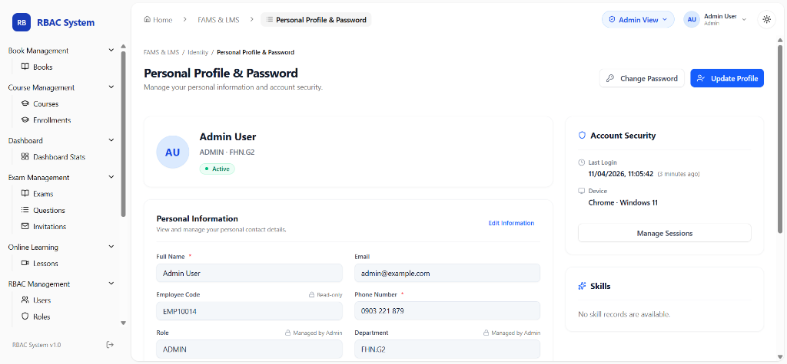
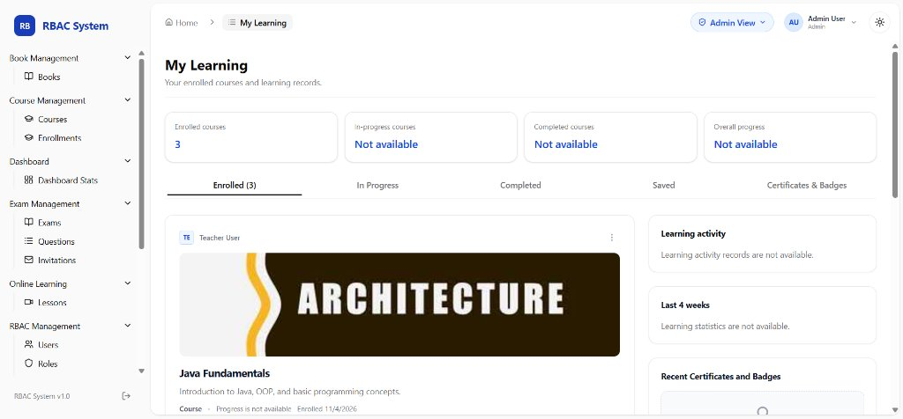
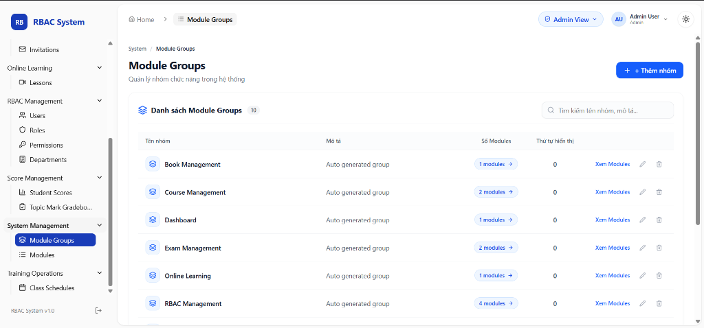
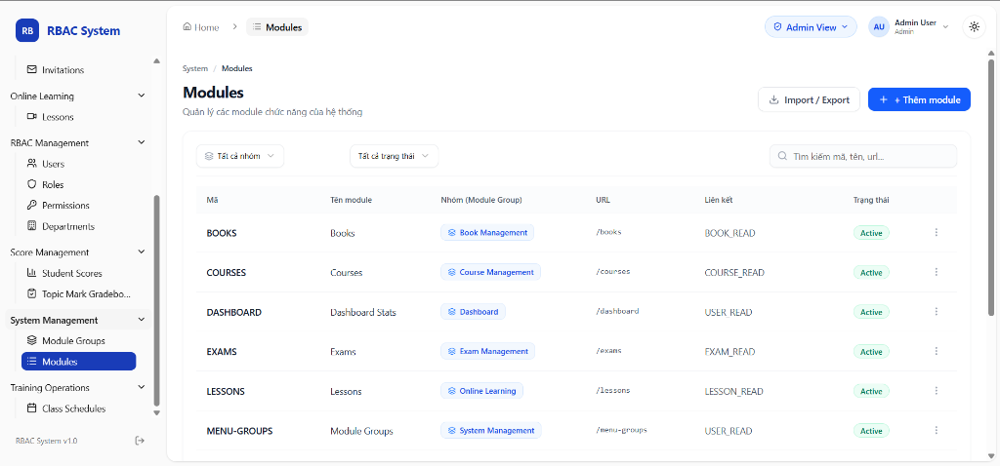

# TÀI LIỆU ĐẶC TẢ YÊU CẦU PHẦN MỀM (SRS)
## DỰ ÁN: HỆ THỐNG QUẢN LÝ ĐÀO TẠO & HỌC TẬP (FAMS & LMS)
**Mã nhóm:** HCM26_CPL_JAVA_10  
**Phiên bản:** 1.2  
**Ngày cập nhật:** 04/11/2026  

---

## MỤC LỤC
1. [GIỚI THIỆU (INTRODUCTION)](#1-giới-thiệu-introduction)
   - 1.1. Mục đích tài liệu
   - 1.2. Phạm vi dự án
   - 1.3. Định nghĩa và từ viết tắt
   - 1.4. Tài liệu tham khảo
2. [TỔNG QUAN HỆ THỐNG (SYSTEM OVERVIEW)](#2-tổng-quan-hệ-thống-system-overview)
   - 2.1. Bối cảnh và mô hình tổng quan
   - 2.2. Các tác nhân trong hệ thống (Actors)
   - 2.3. Môi trường vận hành & Công nghệ sử dụng
3. [YÊU CẦU CHỨC NĂNG (FUNCTIONAL REQUIREMENTS)](#3-yêu-cầu-chức-năng-functional-requirements)
   - 3.1. Chức năng Quản lý hồ sơ cá nhân và Mật khẩu - Personal Profile & Password ([Điền Họ và Tên thành viên])
   - 3.2. Chức năng Khóa học của tôi - My Learning ([Điền Họ và Tên thành viên])
   - 3.3. Chức năng Quản lý Nhóm chức năng - Module Groups ([Điền Họ và Tên thành viên])
   - 3.4. Chức năng Quản lý Module chức năng - Modules ([Điền Họ và Tên thành viên])
   - 3.5. [MẪU TEMPLATE ĐỂ COPY THÊM CÁC CHỨC NĂNG TIẾP THEO]
4. [YÊU CẦU PHI CHỨC NĂNG (NON-FUNCTIONAL REQUIREMENTS)](#4-yêu-cầu-phi-chức-năng-non-functional-requirements)
   - 4.1. Yêu cầu bảo mật (Security)
   - 4.2. Hiệu năng & Khả năng chịu tải (Performance)
   - 4.3. Tính khả dụng & Trải nghiệm giao diện (Usability & Responsive)
5. [BẢNG TỔNG HỢP PHÂN CÔNG CHỨC NĂNG VÀ THÀNH VIÊN](#5-bảng-tổng-hợp-phân-công-chức-năng-và-thành-viên)

---

## 1. GIỚI THIỆU (INTRODUCTION)

### 1.1. Mục đích tài liệu
Tài liệu Đặc tả Yêu cầu Phần mềm (Software Requirements Specification - SRS) này mô tả chi tiết các yêu cầu chức năng, yêu cầu phi chức năng và giao diện vận hành của hệ thống Quản lý Đào tạo & Học tập (**FAMS & LMS**).  
Tài liệu phục vụ cho:
- Giảng viên/Mentor phụ trách môn học và kỳ OJT theo dõi, đánh giá kết quả thực hiện của từng thành viên trong nhóm.
- Nhóm phát triển phần mềm (HCM26_CPL_JAVA_10) làm căn cứ triển khai thiết kế giao diện, lập trình backend/frontend và kiểm thử (testing).

### 1.2. Phạm vi dự án
Hệ thống **FAMS & LMS** hỗ trợ quản lý học viên, giảng viên, khóa học, chương trình học và quản lý hồ sơ thông tin người dùng, bao gồm:
- Xác thực tài khoản (Authentication) & Kiểm soát phân quyền theo vai trò (RBAC).
- Quản lý hồ sơ cá nhân (User Profile), kỹ năng cá nhân và lịch sử học tập.
- Quản lý học tập (My Learning, danh sách khóa học, ghi danh khóa học).
- Quản trị hệ thống động (Quản lý Module Groups, Modules chức năng, Phân quyền Role/Permission, Đơn vị/Phòng ban).

### 1.3. Định nghĩa và từ viết tắt
| Thuật ngữ | Diễn giải |
| :--- | :--- |
| **SRS** | Software Requirements Specification (Đặc tả yêu cầu phần mềm) |
| **RBAC** | Role-Based Access Control (Kiểm soát truy cập dựa trên vai trò) |
| **FAMS** | FPT Academy Management System |
| **LMS** | Learning Management System |
| **JWT** | JSON Web Token (Cơ chế xác thực bảo mật dạng chuỗi mã hóa) |
| **UI/UX** | User Interface / User Experience |

### 1.4. Tài liệu tham khảo
- Tài liệu hướng dẫn đồ án / môn học do giảng viên cung cấp.
- Tài liệu kiến trúc phân quyền và tài khoản (Account roles & learning access).
- Thiết kế cơ sở dữ liệu và Class Diagram của hệ thống.

---

## 2. TỔNG QUAN HỆ THỐNG (SYSTEM OVERVIEW)

### 2.1. Bối cảnh và mô hình tổng quan
Hệ thống được xây dựng theo kiến trúc Client-Server hiện đại:
- **Client (Frontend):** React + TypeScript, Tailwind CSS, Ant Design / Radix UI.
- **Server (Backend):** Java Spring Boot RESTful API, Spring Security, Hibernate/JPA.
- **Database:** MySQL / Docker containerized.

### 2.2. Các tác nhân trong hệ thống (Actors)
- **Guest / Khách:** Người dùng chưa đăng nhập, chỉ có thể xem trang chủ, đăng nhập, quên mật khẩu.
- **Học viên (Student / Learner):** Người học tham gia hệ thống, xem thông tin cá nhân, cập nhật kỹ năng, đăng ký khóa học, theo dõi tiến độ bài học.
- **Giảng viên (Teacher / Lecturer):** Quản lý lớp học, khóa học, tài liệu và điểm số của học viên.
- **Quản trị viên (Admin):** Quản lý toàn bộ người dùng, cấu hình menu động (Module Groups & Modules), cấp phát vai trò, phòng ban và phân quyền chi tiết.

### 2.3. Môi trường vận hành & Công nghệ sử dụng
- **Trình duyệt hỗ trợ:** Google Chrome, Microsoft Edge, Firefox, Safari (Hỗ trợ chuẩn Responsive Desktop và Mobile).
- **Backend Stack:** Java 17+, Spring Boot 3.x, Spring Data JPA, Spring Security JWT.
- **Frontend Stack:** React 18, Vite, TypeScript, React Router, TailwindCSS.

---

## 3. YÊU CẦU CHỨC NĂNG (FUNCTIONAL REQUIREMENTS)

> **QUY ƯỚC CHUẨN THEO YÊU CẦU CỦA GIẢNG VIÊN:**  
> 1. Mỗi chức năng **bắt buộc ghi rõ họ tên thành viên thực hiện** ở tiêu đề (ví dụ: `Chức năng Quản lý hồ sơ cá nhân (Nguyễn Văn A)`).  
> 2. Chụp **toàn màn hình (Full Screen)** chức năng đang chạy thực tế trên trình duyệt (có đầy đủ thanh URL, header, nội dung, sidebar) và dán vào khung chèn ảnh tương ứng.

---

### 3.1. Chức năng Quản lý hồ sơ cá nhân và Mật khẩu - Personal Profile & Password ([Điền Họ và Tên thành viên])
- **Mã chức năng:** `FR-USER-PROFILE-01`
- **Người thực hiện:** `[Điền Họ và Tên thành viên]`
- **Actor:** Mọi người dùng đã đăng nhập hệ thống (Admin, Teacher, Student).
- **Đường dẫn màn hình (URL):** `/fams/ho-so-ca-nhan-oi-mat-khau` (Alias: `/profile`, `/fams/profile`)
- **Breadcrumb:** `Home > FAMS & LMS > Personal Profile & Password`

#### 1. Mô tả tóm tắt:
Chức năng cho phép người dùng đang đăng nhập xem chi tiết toàn bộ hồ sơ cá nhân của mình, trạng thái tài khoản, đơn vị công tác/phòng ban, vai trò hệ thống, thông tin an toàn bảo mật (lần đăng nhập cuối, thiết bị truy cập), danh mục kỹ năng chuyên môn, đồng thời cho phép thực hiện cập nhật thông tin liên hệ và kích hoạt quy trình đổi mật khẩu an toàn.

#### 2. Các thành phần giao diện & Dữ liệu hiển thị:
- **Thẻ tóm tắt thông tin người dùng (Profile Summary Card):**
  - **Avatar đại diện:** Hiển thị chữ cái đầu tên người dùng (Initials, ví dụ: `AU` cho *Admin User*).
  - **Họ và tên:** `Admin User`
  - **Vai trò & Đơn vị trực thuộc:** `ADMIN · FHN.G2`
  - **Trạng thái hoạt động (Status Badge):** Badge trạng thái `Active` màu xanh lục.
- **Thẻ Thông tin cá nhân (Personal Information Card):**
  - **Họ và tên (Full Name)\*:** Cho phép người dùng chỉnh sửa (Bắt buộc).
  - **Email:** Địa chỉ email định danh tài khoản (`admin@example.com`).
  - **Mã nhân viên / Mã định danh (Employee Code):** Hiển thị mã duy nhất (`EMP10014`), chế độ `Read-only` (chỉ đọc, người dùng không thể tự thay đổi).
  - **Số điện thoại (Phone Number)\*:** Số điện thoại liên hệ cá nhân (`0903 221 879`), cho phép chỉnh sửa.
  - **Vai trò (Role):** `ADMIN` kèm ghi chú `Managed by Admin` (Do quản trị viên phân quyền).
  - **Phòng ban / Đơn vị (Department):** `FHN.G2` kèm ghi chú `Managed by Admin`.
  - **Nút "Edit Information" / "Update Profile":** Kích hoạt chế độ chỉnh sửa thông tin trên form.
- **Thẻ An toàn tài khoản (Account Security Card):**
  - **Đăng nhập lần cuối (Last Login):** Thời gian ghi nhận lần đăng nhập gần nhất (ví dụ: `11/04/2026, 11:05:42 (3 minutes ago)`).
  - **Thiết bị & Môi trường truy cập (Device):** Thông tin trình duyệt và hệ điều hành (ví dụ: `Chrome · Windows 11`).
  - **Nút "Manage Sessions":** Mở trang/modal quản lý các phiên đăng nhập đang hoạt động.
- **Thẻ Kỹ năng chuyên môn (Skills Card):**
  - Hiển thị danh mục kỹ năng, chứng chỉ năng lực của nhân sự/học viên (khi chưa có dữ liệu sẽ hiển thị thông báo `No skill records are available.`).
- **Nút hành động trên Header:**
  - **Nút "Change Password":** Mở modal Đổi mật khẩu tài khoản.
  - **Nút "Update Profile":** Kích hoạt lưu dữ liệu thay đổi thông tin cá nhân.

#### 3. Quy trình thực hiện (Main Flow):
1. Người dùng click vào Avatar góc phải trên Navigation Bar hoặc click mục menu cá nhân để truy cập trang Profile.
2. Hệ thống gửi yêu cầu API `GET /api/profile` kèm mã xác thực JWT trong Header.
3. Backend kiểm tra tính hợp lệ của token, truy vấn dữ liệu từ cơ sở dữ liệu và trả về toàn bộ thông tin cá nhân của người dùng.
4. Giao diện render đầy đủ các thông tin: Avatar, Họ tên, Mã nhân viên, Email, SĐT, Vai trò, Phòng ban, Thông tin phiên đăng nhập.
5. Khi người dùng muốn cập nhật:
   - Click nút `Update Profile` hoặc `Edit Information`.
   - Các trường cho phép chỉnh sửa (`Full Name`, `Phone Number`) chuyển sang trạng thái ô nhập liệu (Input field).
   - Người dùng nhập thông tin mới và nhấn nút `Save Changes` / `Update Profile`.
   - Hệ thống kiểm tra hợp lệ phía Client (Họ tên không rỗng, số điện thoại đúng 10 số).
   - Gửi yêu cầu `PUT /api/profile` lên Backend.
   - Khi Backend lưu thành công, hệ thống hiển thị thông báo Toast `"Profile updated successfully!"` và đồng bộ lại tên người dùng trên thanh Header (Redux State).
6. Khi người dùng muốn đổi mật khẩu:
   - Click nút `Change Password`.
   - Hệ thống hiển thị Modal Đổi mật khẩu (`ChangePasswordModal`). Người dùng nhập mật khẩu cũ, mật khẩu mới và xác nhận mật khẩu mới.

#### 4. Quy tắc nghiệp vụ & Ràng buộc (Business Rules):
- **BR-01:** Trường `Employee Code`, `Role`, `Department` là dữ liệu do tổ chức/Admin quản lý nên người dùng chỉ có quyền xem (Read-only), không được tự ý sửa đổi.
- **BR-02:** Email định danh gắn liền với tài khoản đăng nhập; việc thay đổi email cần thông qua quy trình xác thực hai bước hoặc phê duyệt từ Admin.
- **BR-03:** Số điện thoại phải tuân thủ định dạng số di động hợp lệ (10 chữ số).
- **BR-04:** Xử lý xung đột phiên (Optimistic Locking / Conflict): Nếu hồ sơ đã bị sửa đổi từ một phiên khác, hệ thống sẽ cảnh báo `"Update Conflict Detected"` để yêu cầu người dùng tải lại dữ liệu mới nhất.

#### 5. Điều kiện tiên quyết (Preconditions):
- Người dùng đã đăng nhập thành công vào hệ thống và sở hữu Token xác thực hợp lệ.

#### 6. Điều kiện kết thúc (Postconditions):
- Thông tin cá nhân được cập nhật chuẩn xác vào cơ sở dữ liệu, giao diện hiển thị dữ liệu mới nhất.

#### 7. HÌNH ẢNH MINH HỌA GIAO DIỆN (CHỤP TOÀN MÀN HÌNH):

```
+---------------------------------------------------------------------------------------------------+
|  [KHUNG ẢNH TOÀN MÀN HÌNH - CHỨC NĂNG QUẢN LÝ HỒ SƠ CÁ NHÂN & MẬT KHẨU]                            |
|                                                                                                   |
|  * Màn hình: Personal Profile & Password                                                          |
|  * Người thực hiện: [Điền Họ và Tên thành viên]                                                   |
+---------------------------------------------------------------------------------------------------+
```


---

### 3.2. Chức năng Khóa học của tôi - My Learning ([Điền Họ và Tên thành viên])
- **Mã chức năng:** `FR-MY-LEARNING-01`
- **Người thực hiện:** `[Điền Họ và Tên thành viên]`
- **Actor:** Học viên (Student / Learner) hoặc Người dùng có quyền truy cập học tập (`LEARNER_ACCESS`, `LEARNING_SELF_READ`).
- **Đường dẫn màn hình (URL):** `/my-learning` (Alias: `/fams/my-learning`, `/learning`)
- **Breadcrumb:** `Home > My Learning`

#### 1. Mô tả tóm tắt:
Chức năng cung cấp không gian học tập cá nhân hóa cho người học. Cho phép theo dõi số lượng khóa học đã đăng ký, tra cứu các khóa học theo từng trạng thái (Đã ghi danh, Đang học, Đã hoàn thành, Đã lưu trữ), truy cập nhanh vào bài học chi tiết của từng khóa học, đồng thời hiển thị nhật ký hoạt động học tập và chứng chỉ đạt được.

#### 2. Các thành phần giao diện & Dữ liệu hiển thị:
- **Khối Thống kê chỉ số học tập (Top Summary Metric Cards):**
  - **Enrolled courses:** Tổng số lượng khóa học người dùng đã ghi danh (hiển thị số lượng thực tế: `3`).
  - **In-progress courses:** Số lượng khóa học đang tiến hành (hiển thị trạng thái `Not available` khi hệ thống chưa cấu hình bảng ghi nhận tiến độ chi tiết).
  - **Completed courses:** Số lượng khóa học đã hoàn thành (`Not available`).
  - **Overall progress:** Tỷ lệ phần trăm tiến độ tổng thể trên toàn bộ lộ trình (`Not available`).
- **Thanh tab phân loại trạng thái khóa học (Tabs Navigation):**
  - **Tab `Enrolled (3)` (Đang chọn):** Danh sách tất cả các khóa học đã ghi danh thành công kèm số lượng hiển thị trên badge.
  - **Tab `In Progress`:** Bộ lọc danh sách các khóa học đang trong tiến trình học tập.
  - **Tab `Completed`:** Bộ lọc danh sách các khóa học học viên đã hoàn thành 100%.
  - **Tab `Saved`:** Danh sách các khóa học học viên đánh dấu yêu thích/lưu lại.
  - **Tab `Certificates & Badges`:** Quản lý danh mục chứng chỉ và huy hiệu hoàn thành khóa học.
- **Thẻ hiển thị khóa học (Course Card Component):**
  - **Giảng viên phụ trách (Instructor):** Tên và Avatar viết tắt của giảng viên (`TE Teacher User`) kèm menu tùy chọn 3 chấm.
  - **Ảnh bìa khóa học (Course Thumbnail):** Banner hình ảnh đại diện của khóa học (ví dụ banner minh họa `ARCHITECTURE`).
  - **Tiêu đề khóa học (Course Title):** `Java Fundamentals`
  - **Mô tả ngắn gọn (Description):** `Introduction to Java, OOP, and basic programming concepts.`
  - **Thông tin bổ trợ (Metadata):** Định dạng nội dung (`Course`), Tiến độ học tập (`Progress is not available`), Ngày ghi danh (`Enrolled 11/4/2026`).
- **Khối Tiện ích bổ trợ bên phải (Right Sidebar Widgets):**
  - **Hoạt động học tập (Learning activity):** Bảng/lịch ghi nhận thời gian và tần suất học tập trong tuần/tháng (thông báo `Learning activity records are not available.` khi chưa có log).
  - **Thống kê 4 tuần gần nhất (Last 4 weeks):** Biểu đồ thể hiện thời lượng học tập trong 4 tuần qua.
  - **Chứng chỉ và huy hiệu gần đây (Recent Certificates and Badges):** Hiển thị các chứng nhận đạt được gần nhất.

#### 3. Quy trình thực hiện (Main Flow):
1. Người dùng đăng nhập vào hệ thống với vai trò có quyền học tập và chọn menu "My Learning" (hoặc truy cập `/my-learning`).
2. Giao diện kích hoạt React Query gửi yêu cầu API `GET /api/learning/me`. Định danh người dùng được trích xuất hoàn toàn tự động từ `UserPrincipal` trong JWT Token máy chủ, đảm bảo bảo mật và tính toàn vẹn dữ liệu.
3. Máy chủ truy vấn danh sách bản ghi ghi danh (`CourseEnrollment`) của người dùng và trả về danh sách khóa học.
4. Giao diện tự động tính toán tổng số lượng khóa học đã ghi danh (`enrolledCourses.length = 3`) và render:
   - Cập nhật số `3` lên thẻ `Enrolled courses`.
   - Cập nhật nhãn tab thành `Enrolled (3)`.
   - Render danh sách thẻ `CourseCard` tương ứng (Ví dụ: Khóa học *Java Fundamentals*).
5. Khi người dùng click vào thẻ khóa học: Hệ thống chuyển hướng người dùng vào trang giao diện nội dung bài học chi tiết của khóa học đó.
6. Khi người dùng click chuyển sang các tab khác (`In Progress`, `Completed`, `Saved`): Giao diện lọc danh sách khóa học tương ứng với tab đã chọn.

#### 4. Quy tắc nghiệp vụ & Ràng buộc (Business Rules):
- **BR-01:** Bảo vệ quyền riêng tư: Endpoint `/api/learning/me` hoàn toàn không nhận `userId` qua tham số request URL để ngăn ngừa lỗ hổng IDOR (Insecure Direct Object Reference). Mỗi người dùng chỉ truy cập được nhật ký học tập của chính mình.
- **BR-02:** Xử lý dữ liệu chưa sẵn sàng (Graceful Degradation): Với các chỉ số chưa có bảng theo dõi log chi tiết trong database (như thời gian học, tiến độ hoàn thành %), hệ thống hiển thị minh bạch nhãn `"Not available"` thay vì hiển thị dữ liệu giả hoặc gây lỗi giao diện.
- **BR-03:** Người dùng chưa ghi danh bất kỳ khóa học nào sẽ được hiển thị giao diện Empty State với nút liên kết chuyển hướng `"Explore Courses & Enroll"` dẫn đến trang danh mục khóa học chung.

#### 5. Điều kiện tiên quyết (Preconditions):
- Người dùng đã đăng nhập và tài khoản có phân quyền `LEARNER_ACCESS` cùng `LEARNING_SELF_READ`.

#### 6. Điều kiện kết thúc (Postconditions):
- Toàn bộ danh sách khóa học đã ghi danh được hiển thị trực quan và người dùng có thể tương tác học tập.

#### 7. HÌNH ẢNH MINH HỌA GIAO DIỆN (CHỤP TOÀN MÀN HÌNH):

```
+---------------------------------------------------------------------------------------------------+
|  [KHUNG ẢNH TOÀN MÀN HÌNH - CHỨC NĂNG KHÓA HỌC CỦA TÔI (MY LEARNING)]                              |
|                                                                                                   |
|  * Màn hình: My Learning                                                                          |
|  * Người thực hiện: [Điền Họ và Tên thành viên]                                                   |
+---------------------------------------------------------------------------------------------------+
```


---

### 3.3. Chức năng Quản lý Nhóm chức năng - Module Groups ([Điền Họ và Tên thành viên])
- **Mã chức năng:** `FR-SYS-MODULE-GROUP-01`
- **Người thực hiện:** `[Điền Họ và Tên thành viên]`
- **Actor:** Quản trị viên hệ thống (Admin).
- **Đường dẫn màn hình (URL):** `/menu-groups` (Alias: `/system/module-groups`, `/fams/module-groups`)
- **Breadcrumb:** `Home > Module Groups` (Phân hệ: `System / Module Groups`)

#### 1. Mô tả tóm tắt:
Chức năng cho phép Quản trị viên quản lý tập trung các nhóm chức năng cấp cao trong toàn bộ hệ thống (như *Book Management, Course Management, Dashboard, Exam Management, Online Learning, RBAC Management, System Management*...). Hỗ trợ sắp xếp thứ tự hiển thị menu phân cấp trên thanh Sidebar điều hướng, theo dõi số lượng module con đang trực thuộc nhóm, và thực hiện các thao tác quản trị CRUD (Thêm mới, Xem danh sách, Tìm kiếm, Sửa thông tin, Xóa nhóm).

#### 2. Các thành phần giao diện & Dữ liệu hiển thị:
- **Thanh tiêu đề trang & Nút hành động:**
  - **Tiêu đề & Mô tả:** `Module Groups` - *"Quản lý nhóm chức năng trong hệ thống"*.
  - **Nút "+ + Thêm nhóm" (Màu xanh dương nổi bật):** Kích hoạt modal thêm mới nhóm chức năng (`ModuleGroupModal`).
- **Thanh tìm kiếm & Thống kê số lượng:**
  - **Tiêu đề bảng:** `Danh sách Module Groups` kèm Badge số lượng nhóm: `10` nhóm.
  - **Ô tìm kiếm tức thời (Search Box):** Ô nhập với placeholder *"Tìm kiếm tên nhóm, mô tả..."* kèm icon kính lúp, hỗ trợ lọc kết quả động không cần tải lại trang.
- **Bảng dữ liệu danh sách Module Groups (Table Component):**
  - **Cột "Tên nhóm":** Tên nhóm chức năng đi kèm biểu tượng tầng lớp (`Layers` icon). Các bản ghi hiển thị bao gồm:
    * `Book Management`
    * `Course Management`
    * `Dashboard`
    * `Exam Management`
    * `Online Learning`
    * `RBAC Management`
    * ... (tổng cộng 10 nhóm).
  - **Cột "Mô tả":** Mô tả giải thích mục đích của nhóm (ví dụ: `Auto generated group`).
  - **Cột "Số Modules":** Thẻ badge màu xanh nhạt hiển thị tổng số lượng module trực thuộc kèm biểu tượng mũi tên điều hướng (ví dụ: `1 modules ->`, `2 modules ->`, `4 modules ->`).
  - **Cột "Thứ tự hiển thị":** Giá trị số nguyên thể hiện thứ tự ưu tiên xuất hiện trên Sidebar (`0`, `1`, `2`...).
  - **Cột "Thao tác":**
    * **Liên kết "Xem Modules":** Điều hướng nhanh sang trang Modules và tự động áp bộ lọc danh sách module thuộc nhóm này (`/modules?groupId={id}`).
    * **Nút Sửa (Icon bút chì):** Mở modal chỉnh sửa Tên nhóm, Mô tả và Thứ tự hiển thị.
    * **Nút Xóa (Icon thùng rác):** Mở hộp thoại cảnh báo xác nhận xóa nhóm (`DeleteConfirmDialog`).

#### 3. Quy trình thực hiện (Main Flow):
1. Quản trị viên đăng nhập với quyền Admin, chọn menu **System Management** -> **Module Groups** trên Sidebar.
2. Giao diện gọi đồng thời hai API từ máy chủ:
   - `GET /api/module-groups`: Truy vấn danh sách tất cả các nhóm chức năng sắp xếp theo thứ tự `displayOrder` tăng dần và tên nhóm.
   - `GET /api/modules`: Tải danh sách modules để tổng hợp và tính toán số lượng module con (`moduleCount`) cho từng nhóm.
3. Bảng dữ liệu kết xuất đầy đủ 10 nhóm chức năng cùng số lượng module tương ứng.
4. **Quy trình Thêm mới nhóm chức năng:**
   - Quản trị viên nhấn nút `+ + Thêm nhóm`.
   - Hệ thống hiển thị modal nhập liệu: Tên nhóm, Mô tả, Thứ tự hiển thị.
   - Quản trị viên điền thông tin và nhấn "Lưu".
   - Hệ thống gửi yêu cầu `POST /api/module-groups`.
   - Máy chủ tạo mới thành công, giao diện tự động nạp lại danh sách và hiển thị thông báo Toast thành công.
5. **Quy trình Chỉnh sửa nhóm:**
   - Quản trị viên click icon Bút chì tại hàng cần sửa.
   - Modal hiển thị sẵn thông tin hiện tại của nhóm. Quản trị viên sửa đổi và nhấn "Cập nhật" -> Gửi request `PUT /api/module-groups/{id}`.
6. **Quy trình Xóa nhóm chức năng:**
   - Quản trị viên click icon Thùng rác. Hộp thoại xác nhận xuất hiện hỏi: *"Bạn có chắc chắn muốn xóa nhóm chức năng này?"*.
   - Khi xác nhận, hệ thống gửi request `DELETE /api/module-groups/{id}`.
7. **Quy trình Xem nhanh danh sách module con:**
   - Quản trị viên nhấn vào liên kết `Xem Modules` hoặc click vào badge `X modules ->`.
   - Hệ thống chuyển hướng sang trang `/modules?groupId={id}` với bộ lọc nhóm tương ứng đã được thiết lập sẵn.

#### 4. Quy tắc nghiệp vụ & Ràng buộc (Business Rules):
- **BR-01:** Tên nhóm chức năng là trường bắt buộc, không được để trống và không được trùng lặp với các nhóm đã tồn tại.
- **BR-02 (Ràng buộc toàn vẹn dữ liệu):** Nhóm chức năng đang chứa các module con trực thuộc (`moduleCount > 0`) không được phép xóa trực tiếp. Quản trị viên phải chuyển các module con sang nhóm khác hoặc xóa hết module con trước khi thực hiện xóa nhóm.
- **BR-03:** Thứ tự hiển thị (`displayOrder`) phải là số nguyên không âm. Thứ tự này quyết định vị trí sắp xếp trên Sidebar của toàn bộ hệ thống.

#### 5. Điều kiện tiên quyết (Preconditions):
- Người dùng đã đăng nhập với vai trò Quản trị viên (`ADMIN_ACCESS` hoặc quyền `USER_READ`/`SYSTEM_CONFIG`).

#### 6. Điều kiện kết thúc (Postconditions):
- Nhóm chức năng được cập nhật vào cơ sở dữ liệu và cấu trúc menu Sidebar được áp dụng ngay lập tức.

#### 7. HÌNH ẢNH MINH HỌA GIAO DIỆN (CHỤP TOÀN MÀN HÌNH):

```
+---------------------------------------------------------------------------------------------------+
|  [KHUNG ẢNH TOÀN MÀN HÌNH - CHỨC NĂNG QUẢN LÝ NHÓM CHỨC NĂNG (MODULE GROUPS)]                     |
|                                                                                                   |
|  * Màn hình: Module Groups                                                                        |
|  * Người thực hiện: [Điền Họ và Tên thành viên]                                                   |
+---------------------------------------------------------------------------------------------------+
```


---

### 3.4. Chức năng Quản lý Module chức năng - Modules ([Điền Họ và Tên thành viên])
- **Mã chức năng:** `FR-SYS-MODULE-01`
- **Người thực hiện:** `[Điền Họ và Tên thành viên]`
- **Actor:** Quản trị viên hệ thống (Admin).
- **Đường dẫn màn hình (URL):** `/modules` (Alias: `/system/modules`, `/fams/modules`)
- **Breadcrumb:** `Home > Modules` (Phân hệ: `System / Modules`)

#### 1. Mô tả tóm tắt:
Chức năng quản lý danh mục chi tiết từng module chức năng (màn hình tính năng, route điều hướng) của hệ thống. Cho phép Quản trị viên khai báo đường dẫn URL, gắn module vào nhóm chức năng cha (Module Group), chỉ định quyền bảo mật bắt buộc (`Required Permission`) để kiểm soát hiển thị menu và truy cập theo mô hình phân quyền RBAC, kiểm soát trạng thái hoạt động (Active/Inactive), đồng thời hỗ trợ tìm kiếm đa năng, lọc theo nhóm/trạng thái và Import/Export dữ liệu cấu hình.

#### 2. Các thành phần giao diện & Dữ liệu hiển thị:
- **Thanh tiêu đề trang & Nút hành động:**
  - **Tiêu đề & Mô tả:** `Modules` - *"Quản lý các module chức năng của hệ thống"*.
  - **Nút "Import / Export" (Icon download/upload):** Mở modal hỗ trợ tải file mẫu, nhập dữ liệu hàng loạt từ file hoặc xuất danh sách module ra tệp tin.
  - **Nút "+ + Thêm module" (Màu xanh dương nổi bật):** Mở modal khai báo module mới (`ModuleModal`).
- **Thanh công cụ lọc & Tìm kiếm đa tiêu chí (Filter Bar):**
  - **Dropdown "Tất cả nhóm v":** Hộp chọn lọc module theo nhóm chức năng cha (`Book Management`, `Course Management`, `Dashboard`, `Exam Management`, `Online Learning`, `System Management`...).
  - **Dropdown "Tất cả trạng thái v":** Lọc module theo trạng thái `Active` hoặc `Inactive`.
  - **Ô tìm kiếm (Search Input):** Hỗ trợ tìm kiếm theo Mã module, Tên module, hoặc Đường dẫn URL (placeholder: *"Tìm kiếm mã, tên, url..."*).
- **Bảng danh mục Modules (Modules Data Table):**
  - **Cột "Mã":** Mã định danh kỹ thuật viết hoa duy nhất (ví dụ: `BOOKS`, `COURSES`, `DASHBOARD`, `EXAMS`, `LESSONS`, `MENU-GROUPS`).
  - **Cột "Tên module":** Tên tính năng hiển thị trực quan (ví dụ: `Books`, `Courses`, `Dashboard Stats`, `Exams`, `Lessons`, `Module Groups`).
  - **Cột "Nhóm (Module Group)":** Badge màu xanh dương nhạt có icon thể hiện nhóm trực thuộc (ví dụ: badge `Book Management`, `Course Management`, `System Management`...).
  - **Cột "URL":** Đường dẫn định tuyến của tính năng trên hệ thống (ví dụ: `/books`, `/courses`, `/dashboard`, `/exams`, `/lessons`, `/menu-groups`).
  - **Cột "Liên kết" (Required Permission):** Mã quyền hạn bắt buộc trong hệ thống RBAC mà người dùng phải sở hữu để nhìn thấy và sử dụng module này (ví dụ: `BOOK_READ`, `COURSE_READ`, `USER_READ`, `EXAM_READ`, `LESSON_READ`).
  - **Cột "Trạng thái":** Badge trạng thái `Active` màu xanh lục (đang kích hoạt) hoặc `Inactive` (tạm khóa).
  - **Cột "Thao tác":** Menu hành động 3 chấm (`...`) cho phép: Xem chi tiết, Chỉnh sửa module, Bật/Tắt trạng thái, Xóa module.

#### 3. Quy trình thực hiện (Main Flow):
1. Quản trị viên truy cập mục **System Management** -> **Modules** trên Sidebar.
2. Giao diện gửi request API:
   - `GET /api/modules`: Tải danh sách các module sắp xếp theo thứ tự hiển thị và tiêu đề.
   - `GET /api/module-groups`: Tải danh mục nhóm để điền vào dropdown lọc và liên kết nhóm.
3. Bảng dữ liệu hiển thị danh sách các module cùng đầy đủ các trường thông tin mã, nhóm, URL, quyền hạn liên kết và trạng thái.
4. **Quy trình Lọc và Tìm kiếm:**
   - Quản trị viên chọn một nhóm cụ thể từ dropdown "Tất cả nhóm": URL tự động cập nhật tham số `?groupId=...` và danh sách chỉ hiển thị các module thuộc nhóm đó.
   - Nhập từ khóa vào ô tìm kiếm: Hệ thống tự động lọc các bản ghi có mã, tên hoặc URL chứa từ khóa.
5. **Quy trình Thêm mới module:**
   - Quản trị viên nhấn nút `+ + Thêm module`.
   - Form modal xuất hiện yêu cầu nhập: Mã module, Tiêu đề module, Nhóm trực thuộc (chọn từ danh sách nhóm), Đường dẫn URL, Icon đại diện, Quyền hạn bắt buộc (`Required Permission`), Thứ tự hiển thị.
   - Nhấn "Lưu" -> Hệ thống gửi `POST /api/modules` -> Cập nhật bảng dữ liệu và gửi thông báo Toast.
6. **Quy trình Chỉnh sửa & Đổi trạng thái:**
   - Chọn tác vụ Chỉnh sửa từ menu 3 chấm -> Sửa thông tin -> Gửi `PUT /api/modules/{id}`.
7. **Quy trình Nhập/Xuất dữ liệu (Import/Export):**
   - Nhấn nút `Import / Export` -> Chọn tải xuống file cấu hình JSON/Excel danh sách modules hoặc tải lên file dữ liệu mới để đồng bộ cấu hình hàng loạt.

#### 4. Quy tắc nghiệp vụ & Ràng buộc (Business Rules):
- **BR-01:** Mã module (`Code`) phải là duy nhất trên toàn hệ thống, viết hoa, không chứa khoảng trắng hoặc ký tự đặc biệt.
- **BR-02:** Đường dẫn `URL` bắt buộc phải bắt đầu bằng ký tự `/` và phải trỏ đến một route hợp lệ được khai báo trong hệ thống frontend.
- **BR-03:** Mỗi module phải được liên kết với một `Required Permission` hợp lệ. Hệ thống menu Sidebar sẽ tự động ẩn module này đối với các người dùng không có quyền tương ứng trong tài khoản.

#### 5. Điều kiện tiên quyết (Preconditions):
- Quản trị viên đã đăng nhập và sở hữu quyền quản trị cấu hình hệ thống (`ADMIN_ACCESS`).

#### 6. Điều kiện kết thúc (Postconditions):
- Module chức năng mới/cập nhật được lưu thành công, thanh điều hướng Sidebar của hệ thống tự động cập nhật theo cấu hình mới.

#### 7. HÌNH ẢNH MINH HỌA GIAO DIỆN (CHỤP TOÀN MÀN HÌNH):

```
+---------------------------------------------------------------------------------------------------+
|  [KHUNG ẢNH TOÀN MÀN HÌNH - CHỨC NĂNG QUẢN LÝ MODULE CHỨC NĂNG (MODULES)]                          |
|                                                                                                   |
|  * Màn hình: Modules                                                                              |
|  * Người thực hiện: [Điền Họ và Tên thành viên]                                                   |
+---------------------------------------------------------------------------------------------------+
```


---

### 3.5. [MẪU TEMPLATE ĐỂ COPY THÊM CÁC CHỨC NĂNG TIẾP THEO]
*(Các thành viên trong nhóm sao chép mẫu bên dưới để viết thêm cho các chức năng tiếp theo: Quản lý khóa học, Quản lý sách, Đề thi, Phân quyền RBAC...)*

---

#### 3.X. Chức năng [Tên chức năng cụ thể] ([Họ và Tên thành viên thực hiện])
- **Mã chức năng:** `FR-[MODULE]-[STT]` *(Ví dụ: FR-COURSE-01, FR-BOOK-01, FR-EXAM-01)*
- **Người thực hiện:** `[Điền Họ và Tên thành viên]`
- **Actor:** `[Guest / Student / Teacher / Admin]`
- **Đường dẫn màn hình (URL):** `[Ví dụ: /courses hoặc /management/books]`
- **Breadcrumb:** `[Ví dụ: Home > Course Management > Courses]`

##### 1. Mô tả tóm tắt:
`[Mô tả mục đích, ý nghĩa và giá trị của chức năng đối với người dùng]`

##### 2. Các thành phần giao diện & Dữ liệu hiển thị:
- `[Thành phần 1: Tiêu đề, bộ lọc tìm kiếm, nút thêm mới...]`
- `[Thành phần 2: Bảng danh sách dữ liệu, các cột hiển thị...]`
- `[Thành phần 3: Các nút thao tác trên từng dòng: Xem chi tiết, Sửa, Xóa...]`

##### 3. Quy trình thực hiện (Main Flow):
1. Người dùng điều hướng đến màn hình `[URL]`.
2. Hệ thống hiển thị giao diện danh sách/form nhập liệu.
3. Người dùng thực hiện thao tác `[Nhập liệu / Nhấn nút hành động...]`.
4. Hệ thống kiểm tra tính hợp lệ của dữ liệu và gửi yêu cầu API `[Phương thức + Endpoint]`.
5. Máy chủ xử lý thành công, trả về phản hồi và giao diện làm mới dữ liệu.

##### 4. Quy tắc nghiệp vụ & Ràng buộc (Business Rules):
- `[Các quy tắc validate, quyền hạn truy cập, ràng buộc khóa ngoại...]`

##### 5. Điều kiện tiên quyết (Preconditions):
- `[Ví dụ: Đã đăng nhập với tài khoản có quyền Quản trị viên]`

##### 6. Điều kiện kết thúc (Postconditions):
- `[Dữ liệu được lưu trữ an toàn trong DB và phản hồi thành công]`

##### 7. HÌNH ẢNH MINH HỌA GIAO DIỆN (CHỤP TOÀN MÀN HÌNH):

```
+---------------------------------------------------------------------------------------------------+
|  [KHUNG CHÈN ẢNH CHỤP TOÀN MÀN HÌNH - TÊN CHỨC NĂNG]                                              |
|                                                                                                   |
|  * Màn hình: [Tên màn hình]                                                                       |
|  * Người thực hiện: [Họ và Tên thành viên]                                                        |
+---------------------------------------------------------------------------------------------------+
```
*(Chèn ảnh chụp toàn màn hình vào đây)*  
> ![Ảnh chụp toàn màn hình - [Tên chức năng]](duong_dan_anh_cua_ban.png)

---

## 4. YÊU CẦU PHI CHỨC NĂNG (NON-FUNCTIONAL REQUIREMENTS)

### 4.1. Yêu cầu bảo mật (Security)
- Xác thực và ủy quyền dựa trên tiêu chuẩn JWT (JSON Web Token), kết hợp cơ chế Refresh Token an toàn.
- Mật khẩu người dùng được băm (hash) bằng thuật toán BCrypt trước khi lưu trữ trong cơ sở dữ liệu.
- Phân quyền theo cơ chế RBAC nhiều lớp (Route Guard ở Frontend, Spring Method Security `@PreAuthorize` ở Backend). Chặn triệt để lỗ hổng truy cập trái phép IDOR.
- Kiểm soát menu động: Các Module chỉ hiển thị khi tài khoản người dùng có quyền `Required Permission` tương ứng.

### 4.2. Hiệu năng & Khả năng chịu tải (Performance)
- Thời gian phản hồi trung bình của các API truy vấn thông thường dưới 500ms trong điều kiện mạng nội bộ.
- Áp dụng cơ chế phân trang (Pagination) và bộ nhớ đệm (React Query cache) cho các danh mục dữ liệu.

### 4.3. Tính khả dụng & Trải nghiệm giao diện (Usability & Responsive)
- Giao diện thân thiện, tương thích đa thiết bị: Tự động co giãn mượt mà trên Desktop (1920x1080, 1366x768) và Mobile (màn hình chuẩn 390x844px).
- Hỗ trợ chế độ hiển thị Sáng/Tối (Light Mode / Dark Mode).
- Thông báo lỗi và trạng thái thành công rõ ràng, dễ hiểu qua hệ thống Toast thông minh.

---

## 5. BẢNG TỔNG HỢP PHÂN CÔNG CHỨC NĂNG VÀ THÀNH VIÊN

| STT | Mã chức năng | Tên chức năng | Đường dẫn (URL) | Thành viên phụ trách | Trạng thái |
| :---: | :--- | :--- | :--- | :--- | :---: |
| 1 | `FR-USER-PROFILE-01` | Quản lý hồ sơ cá nhân và Mật khẩu (Personal Profile & Password) | `/fams/ho-so-ca-nhan-oi-mat-khau` | `[Họ tên thành viên]` | Đã hoàn thành (100%) |
| 2 | `FR-MY-LEARNING-01` | Khóa học của tôi (My Learning) | `/my-learning` | `[Họ tên thành viên]` | Đã hoàn thành (100%) |
| 3 | `FR-SYS-MODULE-GROUP-01` | Quản lý Nhóm chức năng (Module Groups) | `/menu-groups` | `[Họ tên thành viên]` | Đã hoàn thành (100%) |
| 4 | `FR-SYS-MODULE-01` | Quản lý Module chức năng (Modules) | `/modules` | `[Họ tên thành viên]` | Đã hoàn thành (100%) |
| 5 | `FR-AUTH-01` | Đăng nhập hệ thống (Login) | `/login` | `[Họ tên thành viên]` | Đang cập nhật |
| 6 | `FR-ADMIN-01` | Quản trị người dùng & Phân quyền RBAC | `/users` | `[Họ tên thành viên]` | Đang cập nhật |
| 7 | `FR-...` | `[Tên chức năng tiếp theo]` | `[...]` | `[Họ tên thành viên]` | Đang cập nhật |

---
*(Hết tài liệu)*
