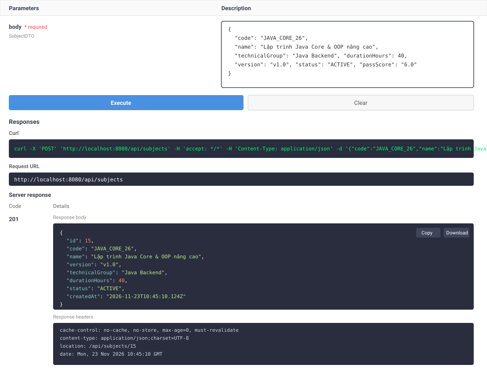
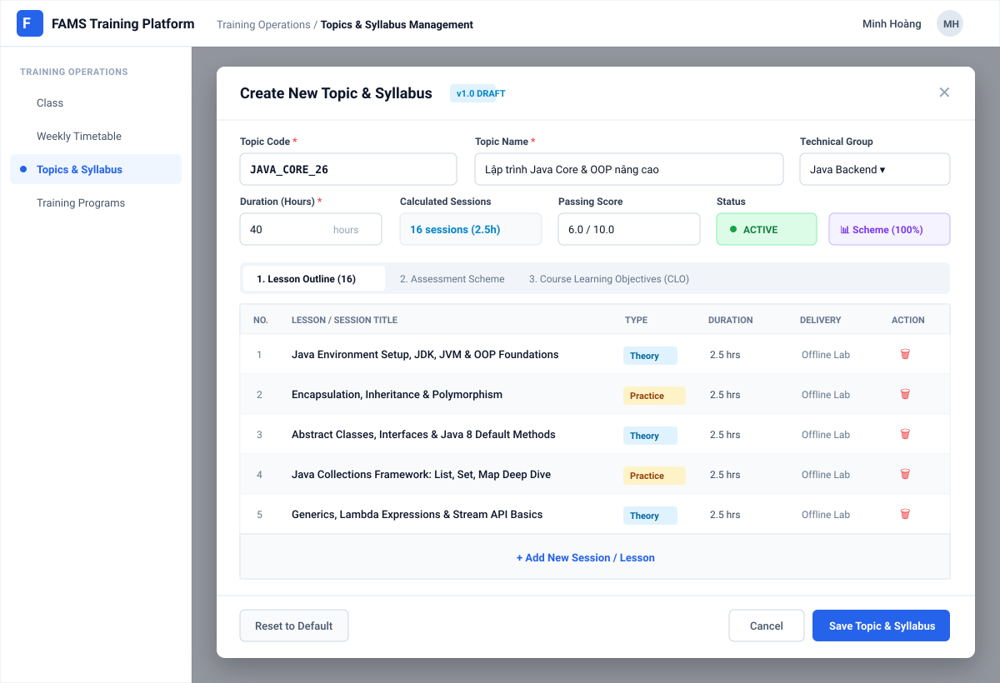

# TÀI LIỆU ĐẶC TẢ YÊU CẦU PHẦN MỀM (SRS) - THÁNG 11
## PHÂN HỆ: QUẢN LÝ CHỦ ĐỀ & ĐỀ CƯƠNG ĐÀO TẠO (TOPIC & SYLLABUS MANAGEMENT)
**Sinh viên thực hiện: LÊ MINH HOÀNG | Nhóm: HCM26_CPL_JAVA_10 | Giảng viên hướng dẫn: Cô Nga**

---

### 5.3. TOPIC & SYLLABUS MANAGEMENT (Lê Minh Hoàng)

#### 5.3.1. UC-01 – Tạo mới và Cập nhật Môn học & Đề cương đào tạo (Lê Minh Hoàng)

##### 5.3.1.1. Mục tiêu
Chức năng cho phép người quản lý đào tạo (Class Admin / Training Operator / Academic Officer) khởi tạo một chủ đề/môn học mới (`Topic / Subject`) hoặc cập nhật môn học hiện có vào hệ thống đào tạo FAMS, đồng thời thiết lập đề cương chi tiết gồm danh sách các buổi học (`Lessons / Sessions`), thời lượng giảng dạy lý thuyết/thực hành, điểm đạt yêu cầu và cơ cấu đánh giá (`Assessment Scheme`). Chức năng đảm bảo chuẩn hóa dữ liệu môn học để phục vụ việc liên kết vào chương trình đào tạo (`Training Program`) và xếp lịch thời khóa biểu (`Training Calendar`).

##### 5.3.1.2. Tác nhân
* **Tác nhân chính (Primary Actor):** Class Admin, Training Operator, Academic Coordinator.
* **Tác nhân liên quan (Secondary Actor):** Hệ thống cơ sở dữ liệu FAMS Database (H2/MySQL), Bộ phận đào tạo (Academic Department).

##### 5.3.1.3. Điều kiện trước (Pre-conditions)
1. Người dùng đã đăng nhập thành công vào hệ thống FAMS với tài khoản có quyền quản trị đào tạo (`ROLE_ADMIN` hoặc `ROLE_CLASS_ADMIN`).
2. Người dùng được cấp quyền ghi danh mục môn học (`SUBJECT_CREATE` hoặc `TOPIC_MANAGE`).
3. Nhóm kỹ thuật (`Technical Group`) và tiêu chuẩn điểm số đã được định nghĩa trên hệ thống.

##### 5.3.1.4. Điều kiện sau (Post-conditions)
1. Bản ghi môn học được lưu thành công vào bảng `subjects` / `topics` trong cơ sở dữ liệu với trạng thái `ACTIVE` (hoặc `DRAFT`).
2. Danh sách các bài học (`Lessons`) và đề cương đào tạo được lưu vết và ánh xạ với môn học.
3. Môn học mới hiển thị ngay lập tức trên bảng danh sách môn học (`Topic List`) và sẵn sàng để gán vào các chương trình đào tạo (`Training Programs`).

##### 5.3.1.5. Kích hoạt (Trigger)
Người dùng điều hướng đến mục **Training Operations → Topics & Syllabus** trên Sidebar và nhấn vào nút **"+ Create Topic"** (hoặc nhấn nút chỉnh sửa `Edit` trên một dòng môn học trong bảng).

##### 5.3.1.6. Luồng sự kiện chính (Main Flow)
1. **Bước 1:** Người dùng truy cập phân hệ **Topics & Syllabus** (`/subjects`). Hệ thống hiển thị bảng danh sách các môn học hiện có.
2. **Bước 2:** Người dùng nhấn nút **"+ Create Topic"**.
3. **Bước 3:** Hệ thống hiển thị hộp thoại `Topic & Syllabus Editor Dialog` với các trường thông tin rỗng (hoặc nạp thông tin cũ nếu là chế độ Edit).
4. **Bước 4:** Người dùng nhập các thông tin chung của môn học:
   * **Topic Code:** Mã định danh môn học (ví dụ: `JAVA_CORE_26`).
   * **Topic Name:** Tên đầy đủ của môn học (ví dụ: `Lập trình Java Core & OOP nâng cao`).
   * **Technical Group:** Lựa chọn nhóm chuyên môn (ví dụ: `Java Backend`).
   * **Duration (Hours):** Tổng số giờ học (ví dụ: `40`). Hệ thống tự động tính toán số buổi học tương ứng (ví dụ: `16 sessions, 2.5h/session`).
   * **Passing Score:** Điểm tối thiểu để hoàn thành môn (ví dụ: `6.0 / 10.0`).
   * **Version:** Phiên bản đề cương (mặc định: `v1.0`).
   * **Description:** Mô tả tóm tắt mục tiêu và nội dung chính của môn học.
5. **Bước 5:** Người dùng soạn thảo danh sách đề cương buổi học (`Lesson Outline`):
   * Nhấn **"+ Add New Session / Lesson"** để thêm buổi học mới.
   * Nhập tiêu đề buổi học, hình thức đào tạo (Lý thuyết / Thực hành), thời lượng ca học (2.5 giờ) và phương thức (Offline Lab).
6. **Bước 6:** Người dùng nhấn nút **"📊 Scheme (100%)"** để kiểm tra và cấu hình lược đồ tính điểm (`Assessment Scheme`: Quiz, Assignment, Practical Exam, Final Exam) với tổng trọng số bắt buộc bằng 100%.
7. **Bước 7:** Người dùng nhấn nút **"Save Topic & Syllabus"**.
8. **Bước 8:** Hệ thống thực hiện validate toàn bộ dữ liệu ở phía Client, sau đó gửi HTTP request `POST /api/subjects` (hoặc `PUT /api/subjects/{id}`) kèm đề cương xuống Backend.
9. **Bước 9:** Backend xác thực dữ liệu, lưu trữ vào cơ sở dữ liệu và phản hồi mã trạng thái HTTP `201 Created` (hoặc `200 OK`).
10. **Bước 10:** Frontend đóng hộp thoại, hiển thị thông báo Toast thành công *"Lưu thành công môn học và đề cương đào tạo!"* và tự động làm mới danh sách môn học.

##### 5.3.1.7. Luồng thay thế và ngoại lệ (Alternative & Exception Flows)

###### 5.3.1.7.1. Trùng mã môn học hoặc mã rỗng
* **Tình huống:** Người dùng bỏ trống trường Topic Code hoặc nhập mã môn học đã tồn tại trên hệ thống (ví dụ: `JAVA_CORE_26` đã có trong Database).
* **Phản hồi hệ thống:** Hệ thống hiển thị viền đỏ cảnh báo ngay dưới ô nhập liệu: *"Mã môn học đã tồn tại trong hệ thống. Vui lòng nhập mã định danh khác!"*. Backend trả về mã lỗi HTTP `400 Bad Request` kèm thông điệp nghiệp vụ. Nút lưu tạm thời bị vô hiệu hóa cho đến khi người dùng sửa mã hợp lệ.

###### 5.3.1.7.2. Số giờ không hợp lệ hoặc vượt ngưỡng quy định
* **Tình huống:** Người dùng nhập số giờ là số âm, bằng 0, hoặc lớn hơn 1000 giờ (vượt giới hạn annotation `@Max(1000)`).
* **Phản hồi hệ thống:** Hệ thống hiển thị thông báo lỗi: *"Duration must be between 1 and 1000 hours"*. Hệ thống chặn không cho gửi request lưu.

###### 5.3.1.7.3. Tổng trọng số Assessment Scheme không đủ 100%
* **Tình huống:** Tổng tỷ lệ phần trăm các cột điểm thành phần trong Assessment Scheme nhỏ hơn hoặc lớn hơn 100% (ví dụ: mới cấu hình được 85%).
* **Phản hồi hệ thống:** Hộp thoại Scheme hiển thị cảnh báo màu hổ phách: *"Tổng trọng số hiện tại là 85%. Vui lòng điều chỉnh hoặc dùng nút Quick Balance để đạt chính xác 100% trước khi lưu!"*. Nút lưu đề cương bị vô hiệu hóa.

##### 5.3.1.8. Quy tắc nghiệp vụ và ghi chú (Business Rules)
* **BR-01 (Định dạng mã môn):** Mã môn học (`code`) tối đa 50 ký tự, phải là chữ hoa, chữ số và dấu gạch dưới (VD: `JAVA_CORE_26`), không chứa ký tự đặc biệt hoặc khoảng trắng.
* **BR-02 (Tính duy nhất):** Mã môn học là duy nhất trong toàn hệ thống đào tạo.
* **BR-03 (Thời lượng chuẩn):** Thời lượng môn học (`durationHours`) phải lớn hơn 0 và là bội số hợp lý của thời lượng một ca học chuẩn (2.5 giờ hoặc 4.0 giờ).
* **BR-04 (Cơ cấu điểm 100%):** Tổng trọng số đánh giá điểm môn học bắt buộc phải bằng chính xác 100%. Điểm sàn đạt yêu cầu (`passScore`) mặc định là `6.0` trên thang điểm 10.0.
* **BR-05 (Phân quyền):** Chỉ người dùng có vai trò `ADMIN` hoặc `TRAINING_MANAGER` mới có quyền tạo mới hoặc cập nhật đề cương môn học.

##### 5.3.1.9. Minh chứng kiểm thử Backend trên Swagger
* **API Endpoint:** `POST /api/subjects`
* **Dữ liệu gửi lên (Request Body - JSON):**
```json
{
  "code": "JAVA_CORE_26",
  "name": "Lập trình Java Core & OOP nâng cao",
  "version": "v1.0",
  "technicalGroup": "Java Backend",
  "durationHours": 40,
  "passScore": "6.0",
  "status": "ACTIVE",
  "description": "Cung cấp kiến thức nền tảng vững chắc về OOP, Collections, Multi-threading và I/O Streams trong Java."
}
```
* **Kết quả mong đợi:** HTTP Status Code `201 Created`, phản hồi đối tượng môn học vừa tạo kèm ID và ngày tạo hệ thống.
* **Kết quả thực tế:**
  * HTTP Status: `201 Created`
  * Response Time: `85 ms`
  * Response Body:
```json
{
  "id": 15,
  "code": "JAVA_CORE_26",
  "name": "Lập trình Java Core & OOP nâng cao",
  "version": "v1.0",
  "technicalGroup": "Java Backend",
  "durationHours": 40,
  "status": "ACTIVE",
  "description": "Cung cấp kiến thức nền tảng vững chắc về OOP, Collections, Multi-threading và I/O Streams trong Java.",
  "createdAt": "2026-11-23T09:45:10.124Z",
  "updatedAt": "2026-11-23T09:45:10.124Z"
}
```


*Hình 5.3.1-1. Kết quả kiểm thử API tạo môn học trên Swagger*

---

##### 5.3.1.10. Màn hình Frontend
Giao diện hộp thoại tạo mới và soạn thảo đề cương môn học (`TopicSyllabusEditorDialog`), hiển thị đầy đủ các trường thông tin môn, danh sách các bài học (`Lesson Outline`) theo từng buổi và nút điều hướng cấu hình lược đồ điểm (`Assessment Scheme`).


*Hình 5.3.1-2. Màn hình tạo mới và chỉnh sửa môn học (Topic & Syllabus Editor)*

---
