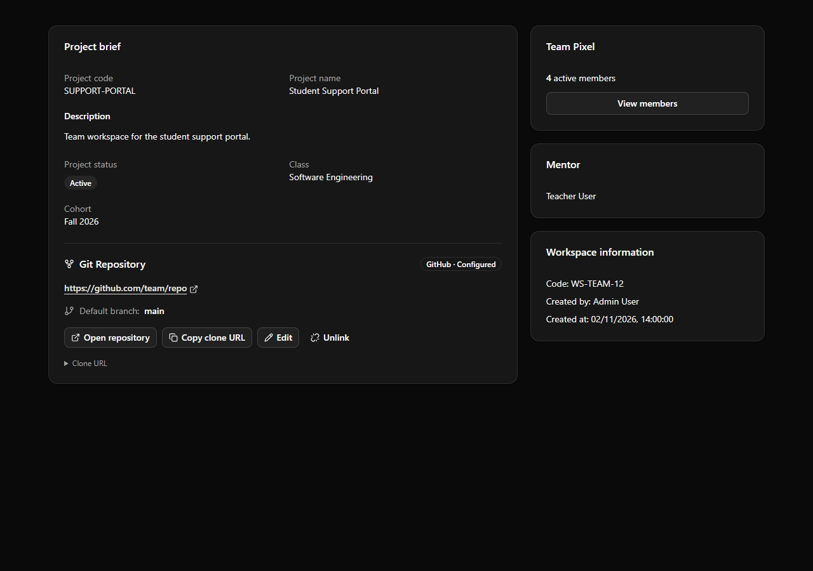

# Workspace Git Repository — US-GIT-001 / US-GIT-002

## Scope and decisions

- UFR-PRJ-010-US01A: link/update/unlink the current team repository and default branch, authorize every request, write audit.
- UFR-PRJ-011-US02A: view and open the repository from Workspace → Overview → Project brief; safe new-tab links and explicit empty/error/loading states.
- Built on `origin/feature/project` at `4d7a4e29`, which includes Sprint 2 PR #194. No changes to database selection, seed flags, credentials or IntelliJ configurations.
- Current code models a Workspace bound to one Team, optionally with a Project. It does not model a Master/Sub-project hierarchy. Configuration is independent per Workspace: no inheritance or fallback to another team's repo. The same panel/API works for project-backed and team-only workspaces. Future parent/child screens must pass their own authorized workspace ID to this module; inheritance is not implied.
- This module stores configuration, not Git authentication. It never clones/fetches, checks network reachability, loads remote branches or stores PATs/passwords/private keys.
- Configuring a repo is not a new prerequisite for artifact submission. Project brief snapshots, drafts and submitted versions are not rewritten.

## Access and storage

Existing WORKSPACE_READ / VIEW_PROJECT_WORKSPACE and the current Workspace authorization are required for reading. This includes active team members, the assigned mentor, and administrators/class managers already permitted to access that Workspace. Tenant isolation, active accounts and current assignments remain enforced by the existing Workspace policy. Active ADMIN/SUPER_ADMIN roles with access to that Workspace, active PM (including multi-role PM,BA), active team members with WORKSPACE_UPDATE, and the currently assigned mentor may link/update/unlink. Admin edit access is intentional per the updated requirement on 3 November 2026; ordinary members and class managers without another edit entitlement remain read-only. No test-mode flag is required.

`project_git_configs.workspace_id` is the primary key and a foreign key to `workspaces.id`. Each row stores tenant/team ownership, sanitized clone/web URLs, provider, branch, revision and actors/timestamps. A write locks the parent Workspace so concurrent first saves cannot create conflicting configurations. Each successful change increments the revision; stale writes/unlinks return 409. Unlink clears the current link and retains the revision. Identical saves do not create extra audit events.

Configuration and `workspace_audits` events (GIT_REPO_LINKED / UPDATED / UNLINKED) commit together. Audit contains actor, server timestamp, workspace/team/tenant, correlation ID and before/after URLs/branch/revision. Audit failure rolls back the configuration. Request DTO logging is redacted before validation.

## URL and branch rules

- GitHub/Bitbucket: HTTPS owner/repo, SCP-style `git@host:owner/repo.git`, or `ssh://git@host/owner/repo.git`.
- GitLab: nested groups are supported; website subpages containing `/-/` are rejected.
- Azure DevOps: modern HTTPS `https://dev.azure.com/org/project/_git/repo`, legacy `https://org.visualstudio.com/project/_git/repo`, and SSH `git@ssh.dev.azure.com:v3/org/project/repo`.
- Self-hosted HTTPS clone paths must end in `.git`. Self-hosted SSH supports an explicit HTTPS repository-page field because SSH host aliases/ports cannot reliably identify a web page.
- Reject unsupported schemes, userinfo credentials in HTTPS, passwords in SSH, queries/fragments, controls, malformed paths and invalid branch ref names. The SSH username `git` is an account identifier, not a private key.
- Validation is structural. It cannot certify that a repository exists, is reachable or grants the browser user access. The badge says **Configured**, not Connected/Verified.
- Open links use the validated HTTPS web URL with `target="_blank" rel="noopener noreferrer"`. Clone URL is separately copyable.

## API

`GET /api/workspaces/{workspaceId}/git-config` returns configured=false/version=0 when no row exists, not a 404. An unlinked row returns configured=false with its retained revision.

`PUT /api/workspaces/{workspaceId}/git-config`:

```json
{
  "version": 0,
  "repositoryUrl": "git@github.com:organization/repository.git",
  "defaultBranch": "main",
  "repositoryWebUrl": null
}
```

`DELETE /api/workspaces/{workspaceId}/git-config?version={currentVersion}` unlinks. Responses include canEdit/canUnlink, provider, clone/web URLs and update metadata. Validation returns 422 with inline field errors, permission failure 403, missing Workspace 404, stale revision 409. Error responses never include rejected raw URLs. UI keeps entered values after failure and provides an explicit reload on conflicts.

## Database deployment

The existing local setting `DB_DDL_AUTO=update` creates the new entity table on restart. It is not changed by this feature. For installations using validate/none, apply the additive `backend/src/main/resources/db/manual/project-git-configs.sql` for MySQL 8, or `project-git-configs-h2.sql` for H2, before deployment. Separate timestamp types match the Hibernate dialects. Neither script changes existing tables/data; both can be applied twice.

Schema tests execute it in H2 default and MySQL compatibility modes, testing its FK and one-row-per-workspace constraint. This is not a live MySQL-server test. Do not drop the table as part of rollback: revert the application code while retaining configuration and audits for a future deployment.

## Acceptance / demo

1. Log in as the assigned Mentor or an active team PM; open Workspace → Overview. An unconfigured card shows the requested empty-state text and **Thêm Git Repository**.
2. Save a supported clone URL and branch. Verify success, provider, branch and **Open repository / Copy clone URL**; refresh and verify persistence. Open the link in a new tab.
3. Try blank/non-repository URLs, credentials in the URL, and an invalid branch. Expect an inline error and no configuration/audit change.
4. Open the same Workspace as an ordinary active Member, or as an Admin/class manager permitted to read the Workspace but not assigned as its member/mentor: the link remains usable, but Edit/Unlink/Add are absent. Direct PUT/DELETE requests must also be rejected.
5. Grant an active member WORKSPACE_UPDATE, or change membership to PM,BA; edit becomes permitted. Revoke it and repeat the API request using the same token: it must fail.
6. With two editors, load revision N in both sessions; save in one and attempt save/unlink from the other. Expect 409, entered values retained, and **Reload latest** before retry.
7. Submit an artifact with repo A, then update current config to B and unlink. Old submission URL/content/version must remain A; the card changes independently.
8. Test another Team/tenant, a revoked membership, locked user, missing Workspace and API failure. None may masquerade as a valid empty state or expose another team's config.
9. For self-hosted SSH, supply its HTTPS repository page explicitly. Confirm the open link uses that page while copying retains the SSH clone URL.

Automated tests cover validators, authorization, owner isolation, database constraints, concurrent first saves, revision conflicts, audit rollback and unchanged submitted artifact snapshots. Browser checks mount the real React component with isolated API fixtures; they do not modify the local demo database and are not a full live end-to-end test.

## Verification result (2 November 2026)

| Check | Result |
|---|---|
| Git repository/branch validation and request-log redaction | 52 tests passed |
| Git configuration API, RBAC/scope, concurrent saves, audit rollback and immutable submission snapshot | 18 tests passed |
| Additive DDL: H2 native and MySQL compatibility mode, repeat application, uniqueness and FK | 2 tests passed |
| Existing Workspace, Board, workflow, milestone/submission, release notes and task alert regression suites | 116 tests passed |
| Total selected backend tests | 188 passed, 0 failures/errors |
| Frontend | TypeScript/Vite production build passed |
| ESLint on the three changed/new frontend files | Passed with the repository config; its declared missing typescript-eslint 8.54.0 was resolved from an isolated temporary installation; no project package/lockfile changes |
| Real React Overview/component browser fixtures | Leader/member empty states, save and safe links, retained input on 409, forbidden state, unlink confirmation and empty state passed |
| Mobile form, 390×844 viewport | Fits within viewport (left 16, right 374); no horizontal dialog overflow |

Review image below uses fixture data and the actual Overview component, not a production/live database:


