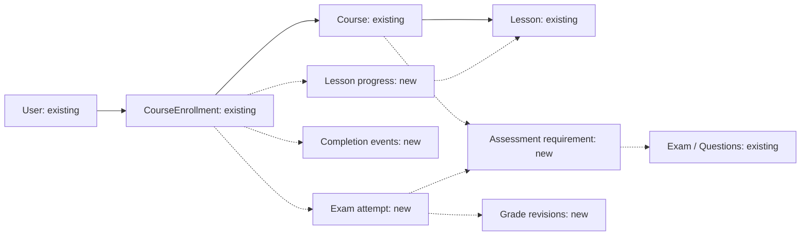

# Learning progress and course completion: design for review

Status: proposed architecture, not approved for implementation. Audited 28 October 2026. Only this design document is being created. No application code, entities, schemas, database records or migrations are changed. This audit examines repository source; deployed database metadata and environment overrides were not inspected.

## 1. Current architecture and relationships

The backend uses Java 21, Spring Boot, Spring Data JPA, transactional services/repositories, shared CRUD infrastructure and existing Role/Permission tables. Extend those mechanisms. LearningRecordsService already supplies a shared personal/administrative read facade; it returns actual enrollments and null for unsupported metrics.

**Persistence prerequisite:** checked-in application.properties uses jdbc:h2:mem:base_crud and Hibernate create-drop. Records do not survive restarts under that profile. MySQL/H2 drivers exist, but no configured Flyway/Liquibase migration workflow was found. Deployment overrides may differ. Confirm a durable database and controlled migrations before production progress rollout; adding entities alone is insufficient.

| Existing model | Relationships and persisted facts | Design implication |
| --- | --- | --- |
| Course / courses | Unique name; description, thumbnailUrl, instructor text | Keep course identity. Instructor is not a User FK or authorization scope. |
| CourseEnrollment / course_enrollments | Required User and Course FKs; unique(user_id, course_id); audit dates | Reuse as ownership boundary. Current cancellation physically deletes the row. |
| Lesson / lessons | Required Course FK; title, videoUrl, description, durationMinutes, orderIndex; unique(course_id, title) | Reuse learning content. Order uniqueness is currently service-validated, not a declared DB unique constraint. |
| Module and ModuleGroup | Navigation Module belongs to ModuleGroup; URL, icon, requiredPermission, ordering | These are menus, not curriculum. Never connect learning completion to them. |
| Exam / exam | Title, duration; many-to-many Question via exam_question | Reuse for quizzes and exams. No course binding exists. |
| Question and QuestionOption | SINGLE_CHOICE, MULTI_CHOICE, ESSAY; points; options with correct flag | Existing authoring data. QuestionTakerMapper already omits answer keys. |
| Invitation / invitations | Exam + User; unique(exam_id,user_id); pending/accepted/rejected/revoked/expired | Reuse eligibility where explicitly required. Invitation acceptance is not an attempt or pass. |
| InvitationAuditLog | Durable invitation-action audit | Keep invitation-specific; do not repurpose as a learning ledger. |
| StudentScore / student_scores and student_score_columns | Unique studentCode, studentName, className, arbitrary score map, overallScore | Persisted legacy gradebook, but no User/Course/Enrollment/Exam FK. Do not automatically treat as completion evidence. |
| TopicMarkDemoService | Uses StudentScore; derives UUID from studentCode; averages available values; demo pass >=5 | Derived UUID is not User.id. History lives in CopyOnWriteArrayList, not the DB. |
| Session / sessions | External scalar classId/topicId/trainerId; scheduling status including COMPLETED | Class-session completion is not an individual's attendance or course completion. No Course/Enrollment relationship. |
| LearningNote / learning_notes | Scalar userId/courseId; text; enrollment-existence check | Notes are not lesson or assessment completion evidence. |
| Assignment, submission, attempt, exam result, certificate | No corresponding persisted domain models found | Do not invent existing links. Add records only for an approved workflow. |

BaseEntity provides Long IDs, isActive, createdAt/updatedAt and actor audit fields. Existing timestamps are LocalDateTime; they do not provide full revision history.

### Services, repositories and endpoints to reuse

- CourseServiceImpl/CourseRepository: CRUD, name validation, /api/courses and /api/courses/{id}, import/export.
- LessonServiceImpl/LessonRepository: course association, title/order validation; /api/lessons and /api/lessons/{id}; existing courseId filter.
- CourseEnrollmentService/CourseEnrollmentRepository: enroll, owned lookup and cancellation; POST /api/enrollments, GET /api/enrollments/my-courses, DELETE /api/enrollments/{id}. Personal controllers already derive identity from UserPrincipal.
- LearningRecordsController/Service: GET /api/learning/me and GET /api/users/{userId}/learning; preserve the shared calculation/read path.
- ExamServiceImpl/ExamRepository: exam CRUD and question association; /api/exams, /api/exams/{id}/questions and /api/exams/{id}/questions/{questionId}.
- ExamTakerController/Service: GET /api/exams/{id}/take reads sanitized active-exam content. It does not persist a start, answers, attempt or grade.
- Invitation services/InvitationRepository: user/exam lookup, CRUD, invitation/resend/revoke actions.
- StudentScoreServiceImpl/Repository: /api/student-scores CRUD/import/export, findByStudentCode, average available score values.
- TopicMarkDemoController: /api/topic-marks/gradebook, /gradebook/search, /students/{UUID}, /history. Direct grade changes overwrite map values; history disappears on restart.
- Module/ModuleGroup CRUD services and repositories: /api/modules and /api/module-groups; retain for navigation only.
- Session services/repository: /api/sessions and /api/sessions/{id}/cancel; retain scheduling meaning.
- Frontend learningApi, LearningRecordsPanel and enrollmentToCourse: existing integration points for My Learning, Profile and administrative User Detail.

### Data gaps and integration blockers

1. No enrollment-specific lesson state, assessment execution/result history, fixed course requirements or completion evidence exists.
2. Enrollment hard deletion is incompatible with durable progress and attempts. Change cancellation retention before introducing evidence FKs.
3. Mutable lessons/exams can change denominators and invalidate achievements unless requirements are pinned.
4. StudentScore identity and score keys do not map to authenticated users or course assessments. StudentScoreDataInitializer upserts sample grades on startup. No automatic completion backfill from those records is valid.
5. TopicMarkDemoController and its direct service methods lack explicit fine-grained authorization checks. SecurityConfig authenticates requests but has no dedicated topic-marks restriction. Harden these routes before trusting their data. This is a source finding, not a live exploit test.
6. ExamTakerService checks an active exam, not enrollment/invitation scope. The old take route cannot bypass the eligibility checks of a new course attempt flow.
7. InvitationValidator checks the STUDENT role name, excluding permission-based custom learners. Use consistent learner capability rules in the proposed flow.
8. Lesson reads require LESSON_READ but not enrollment. Add ownership validation to enrolled-content reads.
9. GenericImportService saves through repositories directly. Publication locks must cover imports and other write paths, not only normal CRUD hooks.

## 2. Recommended progress and completion rules

These are proposed defaults requiring approval, not existing business rules.

### Distinguish the facts

- Enrollment: active/withdrawn membership in a course.
- Participation: a real recorded interaction, not enrollment, login, visiting My Learning, an invitation, or a completed class Session.
- Assessment result: a submitted owned attempt with a final valid grade under pinned rules.
- Completion: all required units satisfied plus a recorded system award decision.

Persist membership as ACTIVE/WITHDRAWN. Derive learning state separately: UNTRACKED, NOT_STARTED, IN_PROGRESS, COMPLETED, COMPLETION_UNDER_REVIEW or COMPLETION_REVOKED. Failed and awaiting-grade attempts count as participation, not satisfied requirements.

### Stable curriculum with minimal schema

Initially publish and freeze completion-relevant course requirements. Course policy state: UNCONFIGURED, DRAFT, PUBLISHED, RETIRED, separate from isActive. Publishing requires reviewed lesson inclusion flags, usable content/assessments and at least one required unit.

After publication, prohibit adding/removing/reassigning/disabling requirement units or changing their completion meaning/thresholds/attempt limits. Cosmetic metadata may change. Retiring prevents new enrollment but allows existing learners to finish retained content; explicit suspension blocks new participation without deleting history or shrinking the denominator.

Use a separate Course record for a new edition initially. This avoids premature CourseVersion/requirement-snapshot tables. If in-place curriculum changes while learners remain enrolled are required, versioned curriculum must be designed before implementation; this is a review gate, not a hidden assumption.

Each published assessment binding pins an immutable Exam/Question/Option/grading-definition snapshot, so editing shared assessment authoring data cannot change an existing course's assessment. Existing lessons are frozen instead of copied into another lesson table.

### Lesson and module rules

Support explicit learner acknowledgement as SELF_REPORTED completion first. Say 'Mark lesson complete'; do not claim verified watching. videoUrl, durationMinutes, client-ended events and client percentages cannot establish independently verified viewing.

Participation/completion commands use server time. A first completion acknowledgement may create first recorded participation at that instant; it does not invent earlier study time. Validate active owned enrollment, published policy and same-course lesson. Repeat completion is a no-op preserving its first timestamp/actor. Optional lessons do not affect required progress. Learner undo/reset after an award is excluded initially.

No pedagogical module exists today. Keep module progress unavailable; do not invent a Module 1 or reuse menu records. Only if real grouping is needed, propose CourseSection plus lesson/assessment section links later. Section completion is derived when all its required units are satisfied; empty sections do not auto-complete. No per-user section-completion table is needed.

### Calculation

R = fixed published required lesson units plus required assessment units. S = units with accepted evidence. Each unit counts once:

- Required lesson: accepted completion record.
- Required assessment: at least one permitted attempt whose latest final valid grade meets its pinned pass threshold.

When |R| > 0: progressPercent = floor(10000 * |S| / |R|) / 100. Equal unit weighting is the initial policy. The boolean eligibility predicate is |S| = |R|, never a rounded-percentage comparison. An incomplete course cannot round up to 100. Assessment score percent remains separate from course progress percent.

Tracked/configured with no evidence means 0% recorded progress. Legacy/unconfigured or zero required units means null, not 0% or 100%. Publication rejects zero required units. Explicit assessment-only courses are permitted.

Write AWARDED in the same transaction that satisfies the final requirement. GET never creates awards. Completion timestamp is server recognition time, not inferred study time. A 100% requirement value can still coexist with an unresolved administrative review; expose that blocker separately rather than marking the award valid. Completion does not imply a certificate.

For account overview, weight by required units across included active courses, not an unweighted average of course percentages. If any included course is untracked, overallProgress stays null with tracked/untracked coverage. No enrollments: real counts are zero, percentage null.

### Assessment, retake and reassessment rules

Reuse Exam for quizzes/exams. Configure threshold and attempt limit explicitly per binding; do not inherit demo >=5 or old UI 80% text. Single-choice uses exact match; multi-choice uses exact selected-option set initially; essays await authorized manual grading. Reject client grades and unknown question/option IDs. Reject zero maximum points or unusable assessment definitions on publication.

Eligibility requires active owned enrollment, same-course requirement, available published policy, remaining attempts and EXAM_TAKE. If invitation mode is explicitly selected, require the applicable accepted/unrevoked/unexpired invitation. Pending is not accepted. Do not enable this mode before an acceptance workflow is available.

Start reserves an attempt number/server deadline. The same idempotency key returns the same attempt. Enforce one active attempt per enrollment/requirement transactionally. Started attempts consume the limit; expiry/abandonment cannot give unlimited retries. Submission is finalized once; after authorization, return an existing same-body result before applying a new deadline check, so a delayed retry does not fail solely because the deadline has since passed. Different-body replay conflicts. Before reserving a new attempt, materialize expiry of an overdue active attempt under the same lock.

A retake is a new attempt. Any current valid pass satisfies the requirement; a later ordinary failure does not erase an earlier valid pass. Initially prohibit new attempts once that requirement is satisfied. Re-enrollment does not reset attempts.

Reassessment appends a grade revision of the same submitted answers; it consumes no new attempt. If correction removes the last qualifying pass after a course award, append REVIEW_REQUIRED. Preserve the historical award/evidence. Authorized review appends UPHELD only if current requirements are satisfied, otherwise REVOKED; no waiver mechanism. Later legitimate requalification produces a new AWARDED event while retaining the previous history.

## 3. Minimum proposed persistence

Full scope includes durable awards, retakes and reassessment: five new tables, introduced in two cuts (two for lesson progress/completion, three for assessments). No duplicate Course, Enrollment, User, navigation Module, Quiz, Assignment or Certificate table.

A lesson-only system could use just lesson progress plus completedAt on CourseEnrollment. That is smaller, but cannot retain award/review/revocation history required by reassessment. The completion-event ledger is justified by that scope; do not also create an independent mutable completion-state table.

### Proposed evidence ownership

Existing records are labelled existing; dashed links introduce proposed records. Administrative navigation modules remain outside this graph.

### Existing records: proposed columns

| Table / columns | Purpose and constraints | Authorization, indexes, migration |
| --- | --- | --- |
| courses: learning_policy_state, learning_published_at | Reviewed curriculum lifecycle; published/retired requires publication time. Existing Course remains identity. | Authoring/publication: ADMIN_ACCESS + COURSE_UPDATE and applicable scope. Legacy courses default UNCONFIGURED; no automatic publication. No state-only index unless measured queries justify it. |
| lessons: required_for_completion | Explicit denominator inclusion. Nullable only before configuration; publication requires true/false per included lesson. Retain Course FK. | Existing editor permissions plus administrative/course scope and publication lock. Add unique(course_id, order_index) only after duplicate audit; it matches existing service intent. |
| course_enrollments: enrollment_status, withdrawn_at, tracking_started_at | Membership lifecycle, retained withdrawal, start of known tracking. WITHDRAWN requires withdrawal timestamp. Legacy tracking time stays null until activation. | Principal ownership on personal commands. Keep unique(user_id,course_id), enrollment ID and createdAt. Suggested index(user_id,enrollment_status,created_at), after checking actual DB indexes. |

Replace physical cancellation with withdrawal, preserving DELETE's 204 response. Evidence survives. Re-enrollment resumes the retained membership/progress/attempts; no limit reset. Update owned-query filters and LearningNote eligibility to check active membership rather than mere row existence. Historical awards remain readable. Fresh cohorts/re-certification need a later explicit enrollment identity policy; do not drop current uniqueness casually.

Existing isActive remains general record availability, not completion/publication. Retain Long identity/audit conventions where appropriate. Never expose generic CRUD/import/delete for evidence or append-only events.

### A. enrollment_lesson_progress — new, lesson cut

- **Purpose/relations:** one existing enrollment's observed participation/completion for one existing Lesson. No duplicate learner or course entity.
- **Columns:** id; enrollment_id FK; lesson_id FK; first_participated_at; last_accessed_at; completed_at nullable; completion_method nullable (SELF_REPORTED initially); completed_by_user_id nullable FK. Keep an explicit completion actor because later access must not overwrite who acknowledged completion.
- **Constraints:** unique(enrollment_id,lesson_id); required reference FKs; chronological server dates; completion date/method/actor must occur together. No stored percentage or extra ownership user_id. A missing row means no recorded evidence, not proof of no earlier participation.
- **Same-course invariant:** validate lesson.course_id = enrollment.course_id inside the enrollment transaction; independent FKs alone do not enforce it. Published lessons cannot move. If DB-level enforcement is mandated, review a redundant course_id plus composite FKs explicitly.
- **Indexes:** enrollment/lesson unique covers enrollment reads; lesson_id FK index for reference checks. Add enrollment/completed_at only if measured aggregates need it.
- **Authorization:** owner-derived personal writes with self-update capability; administrative read under existing inspection policy. No arbitrary-user write endpoint.
- **Migration:** empty table. Never infer completion/access from notes, login, enrollment age, duration or a scheduled Session.

### B. enrollment_completion_events — new, lesson cut

- **Purpose/relations:** durable course-award/review history attached to existing CourseEnrollment. Current completion state is derived from the event sequence, not duplicated in another mutable table.
- **Columns:** id; enrollment_id FK; revision; action AWARDED/REVIEW_REQUIRED/UPHELD/REVOKED; recorded_at; actor_user_id nullable FK (null only for identified system action); reason; immutable evidence_snapshot with schema version, published policy identity, required-unit IDs, accepted lesson evidence and qualifying grade revisions where available.
- **Constraints:** unique(enrollment_id,revision); positive revision; valid transitions; append-only. Same-state reevaluation is a no-op. Never erase the historical AWARDED event. Current award timestamp is the latest still-effective award/requalification, with earlier dates preserved in history.
- **Indexes:** enrollment/revision unique supports latest-state lookup; aggregate latest events through enrollment joins. Do not add an identical-prefix index.
- **Authorization:** AWARDED/REVIEW_REQUIRED are internal outcomes of authorized evidence/grading transactions. Human review needs explicit write capability, target validation and reason. No client-created award.
- **Migration:** empty table. Enrollment or demo pass flags cannot justify historical award events. Snapshots are bounded, server-generated provenance, not arbitrary client JSON.

### C. course_assessment_requirements — new, assessment cut

- **Purpose/relations:** explicit existing Course-to-Exam association and fixed assessment rules; no such relation currently exists.
- **Columns:** id; course_id FK; exam_id FK; display_order; pass_percentage fixed decimal; max_attempts; eligibility_mode ENROLLMENT/INVITATION; immutable definition_snapshot containing question/option definition, answer keys, points, duration and grading-rule version at publication.
- **Constraints:** unique(course_id,exam_id) for one required occurrence; threshold >0 and <=100; positive bounded attempts; usable nonempty snapshot. Initial rows are all mandatory; optional practice exams do not need a counting requirement. Multiple required occurrences require a future explicit identity, not accidental duplicates.
- **Indexes:** course/exam unique for course loading; exam_id FK index where not already provided.
- **Authorization:** ADMIN_ACCESS + COURSE_UPDATE + EXAM_READ and applicable course scope; DRAFT editing only. Snapshot answer keys never appear in learner progress or ordinary admin learning DTOs.
- **Migration:** empty. No inferred relation from exam title, invitations, class names or grade-map keys. Published snapshots are immutable even if shared authoring data changes.

### D. exam_attempts — new, assessment cut

- **Purpose/relations:** an owned enrollment's execution of one course requirement, separate from invitation and grade.
- **Columns:** id; enrollment_id FK; assessment_requirement_id FK; attempt_number; start_request_key; state IN_PROGRESS/SUBMITTED/EXPIRED; started_at; deadline_at; submitted_at nullable; submitted_answers payload; answer_digest. Requirement snapshot pins the exact content version.
- **Constraints:** unique(enrollment_id,requirement_id,attempt_number) and unique(enrollment_id,requirement_id,start_request_key); chronological times; one finalized submission; same-course binding; question/option membership validation. Transactional enrollment lock enforces one live attempt and limit checks.
- **Storage:** submitted answers are a bounded validated execution snapshot, not a second question bank. No per-question entity initially; normalize later only for approved autosave/per-answer query requirements.
- **Indexes:** composite unique supports enrollment/requirement history; requirement FK index if needed. No redundant user_id ownership field.
- **Authorization:** principal-owned enrollment, learner-write, EXAM_TAKE and requirement eligibility. No generic update/delete/import.
- **Migration:** empty. Taking an exam content GET or receiving an invitation must not create a historical attempt.

### E. exam_attempt_grades — new, assessment cut

- **Purpose/relations:** immutable initial/revised results attached to an attempt; no fabricated attempt for an unverified legacy grade.
- **Columns:** id; attempt_id FK; revision; decision FINAL/INVALIDATED; earned_points/maximum_points for FINAL; per-question grading breakdown; graded_at; grader_user_id nullable FK for system grading; reason. Pinned binding holds threshold/rubric.
- **Constraints:** unique(attempt_id,revision); 0 <= earned <= maximum and maximum >0; invalidation has no score; manual correction/invalidation requires actor/reason. Maximum points come from the pinned definition, not a grader/client override; validate every awarded question score against that definition. Pass derives from latest revision and pinned threshold. Replayed submission does not generate duplicate grades.
- **Indexes:** attempt/revision unique supports effective result. Add actor index only for a demonstrated audit query.
- **Authorization:** internal automatic grader; manual grading/regrading requires ADMIN_ACCESS + USER_READ + USER_LEARNING_READ + STUDENT_SCORE_UPDATE plus target/attempt scope. Instructor text/Teacher role alone does not grant it.
- **Migration:** empty. StudentScore.overallScore, generated UUIDs and demo pass flags cannot be converted automatically. Preserve legacy gradebook functionality pending a verified bridge.

Use restrictive evidence FKs and explicit retention/anonymization, never cascade away achievements. New learning event times use UTC instants/ISO-8601; existing LocalDateTime values need a separately verified timezone interpretation, not guessed conversion. Native JSON versus validated text is a target-database storage decision; require versioned payload validation either way. No executable schema/migration is included here.

## 4. Services, consistency and ownership

Keep LearningRecordsService as the shared read facade. A LearningProgressService batch-loads scoped enrollments, lessons, evidence, requirements and effective grades; a pure CompletionEvaluator applies the same rules for personal and admin reads. A transactional writer appends completion decisions. ExamAttemptService reuses existing authoring repositories/sanitized mapping rather than creating another course or exam architecture.

For a transition: lock enrollment; validate owner/target, policy and state; lock subordinate attempt if applicable; persist evidence; evaluate; append completion transition; commit together. All writers use enrollment-first lock order. Unique constraints defend against duplicates; bounded retries handle transient conflicts. Publication locks Course and validates/freezes requirements before new tracked enrollments.

Do not persist course percentages independently. Avoid per-lesson/per-course N+1 queries; batch and aggregate. No event bus, Redis counter or asynchronous queue is required for initial correctness. GET does not award completion; reconciliation reports invalid/unavailable state rather than creating invented evidence. A later certificate-notification side effect may justify an outbox separately.

## 5. Proposed API contracts

Personal identity always comes from UserPrincipal. Resource IDs select owned resources, never the acting user. Strict write DTOs reject arbitrary userId, scores, passed flags, percentages and completion dates.

**Authorization:** personal reads retain LEARNER_ACCESS + LEARNING_SELF_READ. Progress writes need proposed LEARNING_SELF_UPDATE plus LEARNER_ACCESS; attempt commands also require EXAM_TAKE. Introduce the write action in existing permission tables/mappings only after approval, not a second RBAC system and not an automatic admin learning grant. READ must not imply WRITE.

Administrative reads retain ADMIN_ACCESS + USER_READ + USER_LEARNING_READ; validate target existence and enrollment. Manual grading additionally requires existing STUDENT_SCORE_UPDATE. Human course-completion review additionally needs proposed USER_LEARNING_UPDATE, with explicit approved mappings. No waiver/unrestricted mark-another-user-complete operation. USER_READ currently represents global scope; no tenant/trainer/department scope can be inferred.

| Method/path | Contract |
| --- | --- |
| GET /api/learning/me (existing) | Add per-enrollment progress/completion and tracking coverage. Preserve existing fields/list shape; certificates remain null until supported. |
| GET /api/enrollments/my-courses (existing) | Preserve list and existing fields; optional additive progress object from shared calculator. Do not replace with a page wrapper. |
| GET /api/learning/me/courses/{courseId}/progress | Owned enrollment/membership, recorded participation, requirement counts, percentage, lesson evidence and assessment summaries. |
| GET /api/learning/me/courses/{courseId}/completion | Current completion decision, award/review history and blockers; no writes. |
| GET /api/learning/me/courses/{courseId}/lessons | Existing lesson mapping with enrollment scope; authoring/catalog reads are not a substitute. |
| PUT /api/learning/me/courses/{courseId}/lessons/{lessonId}/participation | Record server-observed first/latest participation, no claimed study duration. Debounce UI writes. |
| PUT /api/learning/me/courses/{courseId}/lessons/{lessonId}/completion | method=SELF_REPORTED; idempotent acknowledgement; return canonical updated progress. |
| POST /api/learning/me/courses/{courseId}/assessments/{requirementId}/attempts | Idempotency-Key required; reserve attempt/deadline; sanitized pinned content; 201 creation/200 replay. |
| GET /api/learning/me/exam-attempts/{attemptId} | Owner-only state and released result; answer-key release follows approved assessment policy. |
| PUT /api/learning/me/exam-attempts/{attemptId}/submission | Answer IDs/text only. Finalize once; auto-grade supported choices or await essay grading. |
| GET /api/users/{userId}/learning (existing) | Add selected-user progress using same calculator, existing admin guard and target scope. |
| GET /api/users/{userId}/learning/courses/{courseId}/progress or /completion | Scope both selected user and course enrollment; identical calculation semantics. |
| POST /api/users/{userId}/learning/exam-attempts/{attemptId}/grades | Append grade/revision, expectedRevision and reason; target owns attempt; prohibit human self-grading. |
| POST /api/users/{userId}/learning/courses/{courseId}/completion-review | Authorized UPHELD/REVOKED, expectedRevision/reason, current evidence check. Cannot directly fabricate AWARDED. |
| POST /api/courses/{courseId}/learning-policy/publish | Administrative COURSE_UPDATE transition after validated configuration. |
| POST/PUT/DELETE /api/courses/{courseId}/assessment-requirements[/{id}] | DRAFT configuration under ADMIN_ACCESS + COURSE_UPDATE + EXAM_READ and applicable scope. |

The progress DTO contains contract fields, not example learner data: enrollmentId, courseId, enrollmentStatus; tracking state AVAILABLE/UNCONFIGURED/LEGACY_UNTRACKED and startedAt; first/last recorded participation; requiredUnits/satisfiedUnits/percent; learningStatus; completion state/currentAwardedAt/latestRevision; lesson/assessment summaries; stable blocker codes REQUIRED_LESSONS_REMAIN, ASSESSMENT_NOT_PASSED, AWAITING_GRADE or TRACKING_UNAVAILABLE. Keep assessment scorePercent separate from course progressPercent.

Responses: 401 unauthenticated; 403 missing capability; 404 absent/non-owned nested resource; 409 withdrawn/suspended enrollment, frozen policy, deadline/limit, stale revision or changed submission replay; 400 invalid body/question/option membership. Validate scope before revealing another user's attempt existence.

The existing /api/exams/{id}/take remains content-read compatibility only, never an attempt/completion write. Its use for course-bound content must honor the new eligibility policy. Harden direct legacy gradebook APIs before trusting them. No existing API response is silently replaced.

## 6. Integration with existing UI

| Existing UI | Data integration, retaining components/themes |
| --- | --- |
| My Learning CourseCard | Extend enrollmentToCourse with actual learningStatus, percent, recorded last access and current award date. NOT_STARTED is enrolled with 0 tracked progress; UNTRACKED retains null and availability explanation. |
| Course progress bars | Show only for available tracking with requiredUnits >0; use server value, never infer from duration, notes or enrollment age. |
| In Progress tab | Real participation/progress and awaiting-grade states; enrollment alone does not imply started. |
| Completed tab | Currently effective AWARDED/UPHELD outcomes. Review/revoked achievements get distinct historical/review presentation, never an ordinary valid-completion badge. |
| Profile Learning Overview | Same /learning/me data and personal read gate. Real counts, coverage-aware percentage and authorized zero-enrollment state. No target-user parameter. |
| User Detail Learning | Same DTO/calculator through admin endpoint with selected target and account/target-specific query key. |
| Activity/statistics/certificates | A limited timeline can project real evidence/attempt/grade events. Daily goals, total study time and certificates stay unsupported without their own records. durationMinutes is not actual time studied. |

Preserve CourseCard, LearningRecordsPanel, existing tabs, Profile overview, header, breadcrumbs, responsive grids, blue accent and light/dark tokens. No redesign. After a successful write, invalidate that account's personal course/list/overview keys and any authorized admin cache for the same learner. Preserve session/permission cache clearing. Write controls require self-update/assessment permission, not just read access.

The current certificate API field is a nullable string list while UI certificate components expect structured information. Do not silently change the element type in a progress release; certificate issuance, verification and DTO versioning are separate work. Saved courses also remain unsupported until persisted.

## 7. Database migration considerations

1. Inventory deployed database/configuration, schema, FKs, indexes and backups without starting against create-drop. Confirm durable storage and restore rehearsal. Select a controlled migration runner through deployment review; do not rely on Hibernate schema recreation for production upgrades.
2. Add default-safe/nullable configuration and tracking fields and empty evidence tables. Match existing Long FK types. Keep old APIs and unavailable UI states operational during rollout.
3. Audit duplicate lesson ordering before adding course/order uniqueness. Do not silently reorder published lessons.
4. Legacy courses remain UNCONFIGURED; legacy enrollments remain LEGACY_UNTRACKED. Publishing does not establish old participation. Use a reviewed activation operation to start tracking from now. Never backfill completion from enrollment, notes, login timestamps, gradebook demo rows or class-session state.
5. Retain withdrawn enrollments/evidence-bearing content before tracking is enabled. Add restrictive reference handling; update active-membership queries and LearningNote checks. Preserve IDs, createdAt and user/course uniqueness. Physically deleted historical enrollments cannot be reconstructed without trustworthy external evidence.
6. Review required lessons, assessment thresholds/scale, attempts and eligibility per course. Freeze policy after publication. Cover regular CRUD, imports/bulk actions and maintenance paths. Keep sample initializers development-only; they must not overwrite real grades or published content.
7. Add approved LEARNING_SELF_UPDATE/USER_LEARNING_UPDATE to the existing permission model with idempotent mappings. STUDENT may receive self-write by reviewed policy; ADMIN-only and Teacher do not automatically receive personal learning. Review custom-role mappings explicitly.
8. Any legacy grade integration requires curated User-to-studentCode and course/assessment-key mapping, explicit score scale, verification and provenance. Generated UUIDs, matching names and guessed email addresses are not joins. Do not fabricate attempts for old grades. Keep existing gradebook functioning; do not dual-write competing sources of truth.
9. Verify durability across process restart, version upgrade and rollback on the target DB. Feature rollback disables new writes/UI while retaining evidence; do not delete achievements. New UTC timestamps do not justify guessing timezone conversions of existing LocalDateTime data.
10. Shadow-check calculations before exposing percentages; enable per reviewed course. Assess migration concurrency and lock behavior on the selected DB. Unconfigured courses continue to return null metrics rather than misleading zeroes.

## 8. Incremental implementation plan, after approval

1. **Approve policy and operations:** durable DB/migration workflow; acknowledgement versus verified completion; freeze versus course versions; enrollment resume; thresholds/attempts; grading/review authority. Obtain actual DB inventory and rehearsal plan.
2. **Publishable lesson curriculum:** reviewed Course lifecycle and Lesson inclusion flags; publication validation; frozen requirements enforced across all writers. Existing unconfigured courses remain unchanged.
3. **Lesson evidence and completion:** withdrawal retention/tracking activation, lesson-progress and completion-event tables, pure evaluator and transactional event writer. Verify ownership, wrong-course IDs, retries, concurrent final completions, zero-unit behavior, restart durability and resume.
4. **Read contracts/UI:** additive personal/admin progress DTOs; existing cards, bars, tabs and Profile mapping. Verify all role combinations, cache isolation, coverage/empty states and light/dark responsive layout.
5. **Assessments:** existing Exam/Question authoring plus requirement snapshots, attempt reservation/submission and grade storage. Test invitation/enrollment eligibility, deadline/limits, replay, immutable published definitions, auto/manual grading and answer-key secrecy. Assessment-gated courses cannot publish before this cut works.
6. **Reassessment/review:** immutable grade revisions and completion review decisions with expected revisions/reasons. Test pass-to-fail corrections, remaining earlier pass, concurrent grades, uphold/revoke/requalification and prohibited self-grading/waivers. Do not enable grade corrections that affect awards without this workflow.
7. **Optional later work:** CourseSection grouping, verified video evidence, assignment submission/rubrics, curated legacy-grade bridge, certificates, time analytics, fresh cohorts/re-certification. Each requires its own approved evidence/authorization design, not automatic extra entities.

Use integration tests on the selected durable database as well as unit/H2 tests. Key acceptance cases: duplicate completion preserves one record; simultaneous last units create one award transition; no active enrollment/wrong user/wrong course cannot mutate; pending grades do not pass; ordinary failed retake does not remove an earlier valid pass; reassessment revisions remain distinguishable from retakes; publication changes cannot alter earned requirements; withdrawal preserves evidence; admin read matches the target while personal read cannot select another user.

No implementation tests were run for this task because no implementation is being changed and default application startup can recreate the local database. The above tests are the proposed verification plan, not claimed executions.

## 9. Risks and unresolved design decisions

| Decision/risk | Recommended default / approval needed |
| --- | --- |
| Trust level for lesson completion | Explicit SELF_REPORTED acknowledgement; independently verified playback/attendance needs another integration. |
| Curriculum edits | Freeze published requirements. If in-place changes are needed, design versions before shipping; this materially changes schema. |
| Mandatory assessments | Explicit per-course binding, not universal. Content-only completion is allowed only when deliberately configured. |
| Passing and retakes | Explicit positive threshold/limit; any current valid pass; no universal demo or UI threshold. Review whether abandoned starts consume attempts. |
| Exam invitations | Explicit eligibility mode; invitation-gated launch depends on actual acceptance flow. Custom learner eligibility must use capabilities, not just role name. |
| Grader/reviewer authority | Existing score-update plus target read scope for grading; explicit learning-update permission for review. Teacher/instructor text is not a target authorization model. |
| Award correction | Review preserves history and prevents displaying an invalid award as current. Approve revoke/uphold/requalification rules and retention before enabling post-award corrections. |
| Repeat enrollment/certification | Resume one retained enrollment initially. Fresh cohort/re-certification requires reviewing unique(user,course). |
| Existing gradebook | Verify ownership/scale/provenance before reuse; its demo identity/history cannot become authoritative evidence. Harden direct endpoints before integration. |
| Analytics and certificates | Completion does not prove time studied, daily goals, certificate issuance or assignment submission. Keep unsupported values null. |
| Privacy/retention | Define answer/essay retention, sensitive grading feedback release, actor anonymization and snapshot size bounds. No cascading evidence deletion. |
| Performance | Derive percentages from fixed requirements; batch queries and measure before adding cached projections/indexes. |
| Deployment | Checked-in H2/create-drop is not durable storage. Confirm production overrides and choose migrations; do not assume existing deployment is safe. |

### Scope boundaries and source evidence

This proposal deliberately retains existing course/enrollment/lesson/exam/question/gradebook/navigation models. No application fixes, database inspection, seed creation or migrations were performed. The authorization/import findings above remain findings for the approved implementation, not changes made during this audit.

- [Course](D:/FPT_OJT/HCM26_CPL_JAVA_10_user-profile-update/backend/src/main/java/com/example/starter_project_2025/system/demo/course/Course.java:30)
- [Enrollment uniqueness](D:/FPT_OJT/HCM26_CPL_JAVA_10_user-profile-update/backend/src/main/java/com/example/starter_project_2025/system/demo/enrollment/CourseEnrollment.java:18)
- [Physical cancellation](D:/FPT_OJT/HCM26_CPL_JAVA_10_user-profile-update/backend/src/main/java/com/example/starter_project_2025/system/demo/enrollment/CourseEnrollmentService.java:52)
- [Lesson/course content](D:/FPT_OJT/HCM26_CPL_JAVA_10_user-profile-update/backend/src/main/java/com/example/starter_project_2025/system/demo/online_lession/Lesson.java:35)
- [Navigation Module](D:/FPT_OJT/HCM26_CPL_JAVA_10_user-profile-update/backend/src/main/java/com/example/starter_project_2025/system/menu/module/Module.java:33)
- [Navigation ModuleGroup](D:/FPT_OJT/HCM26_CPL_JAVA_10_user-profile-update/backend/src/main/java/com/example/starter_project_2025/system/menu/module_groups/ModuleGroup.java:38)
- [Exam authoring relation](D:/FPT_OJT/HCM26_CPL_JAVA_10_user-profile-update/backend/src/main/java/com/example/starter_project_2025/system/exam/domain/Exam.java:37)
- [Read-only exam taking](D:/FPT_OJT/HCM26_CPL_JAVA_10_user-profile-update/backend/src/main/java/com/example/starter_project_2025/system/exam/service/ExamTakerService.java:24)
- [Question types](D:/FPT_OJT/HCM26_CPL_JAVA_10_user-profile-update/backend/src/main/java/com/example/starter_project_2025/system/question/domain/QuestionType.java:3)
- [Invitation eligibility](D:/FPT_OJT/HCM26_CPL_JAVA_10_user-profile-update/backend/src/main/java/com/example/starter_project_2025/system/invitation/service/InvitationValidator.java:75)
- [Legacy persisted gradebook](D:/FPT_OJT/HCM26_CPL_JAVA_10_user-profile-update/backend/src/main/java/com/example/starter_project_2025/system/demo/student_score/StudentScore.java:50)
- [In-memory grade history](D:/FPT_OJT/HCM26_CPL_JAVA_10_user-profile-update/backend/src/main/java/com/example/starter_project_2025/system/topic_mark/TopicMarkDemoService.java:49)
- [Derived gradebook UUID](D:/FPT_OJT/HCM26_CPL_JAVA_10_user-profile-update/backend/src/main/java/com/example/starter_project_2025/system/topic_mark/TopicMarkDemoService.java:420)
- [Direct gradebook endpoints](D:/FPT_OJT/HCM26_CPL_JAVA_10_user-profile-update/backend/src/main/java/com/example/starter_project_2025/system/topic_mark/TopicMarkDemoController.java:29)
- [Learning facade](D:/FPT_OJT/HCM26_CPL_JAVA_10_user-profile-update/backend/src/main/java/com/example/starter_project_2025/system/learning/LearningRecordsService.java:13)
- [Existing personal/admin guards](D:/FPT_OJT/HCM26_CPL_JAVA_10_user-profile-update/backend/src/main/java/com/example/starter_project_2025/system/learning/LearningRecordsController.java:12)
- [Repository import path](D:/FPT_OJT/HCM26_CPL_JAVA_10_user-profile-update/backend/src/main/java/com/example/starter_project_2025/base/dataio/importer/service/GenericImportService.java:51)
- [Database default](D:/FPT_OJT/HCM26_CPL_JAVA_10_user-profile-update/backend/src/main/resources/application.properties:12)
- [Development grade seeds](D:/FPT_OJT/HCM26_CPL_JAVA_10_user-profile-update/backend/src/main/java/com/example/starter_project_2025/init/StudentScoreDataInitializer.java:30)
- [Shared UI](D:/FPT_OJT/HCM26_CPL_JAVA_10_user-profile-update/frontend/src/pages/management/learning/components/LearningRecordsPanel.tsx:15)
