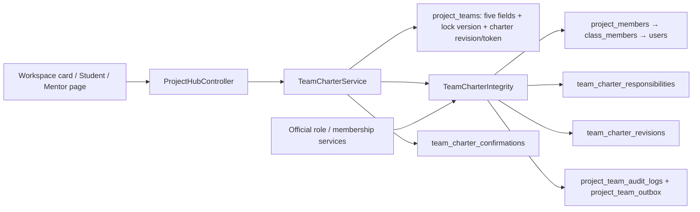

# UFR-PEO-013 — Team Charter

Owner: Tran Trong Hoa (DEV 4). Implementation: `feature/team-charter`, based on `1429b4def`.

This completes the six working User Stories in v1.1: view, compose/preview/save, self-confirm, renew consent, track progress and read history. The detailed draft/confirmation policies follow the implementation decisions documented at checkpoint 1; they are not presented as verbatim rules from the original unified SRS. No automatic Start Sprint gate, Mentor approval flow, email campaign or extra project-role catalogue is introduced.

## Where to open it

- **Workspace → Overview → Team charter → Open team charter**.
- Student/direct route: `/student/team/charter?teamId=<canonical ProjectTeam ID>&workspaceId=<Workspace ID>`.
- Mentor overview: `/mentor/teams`. An editor can reach this through **View team charter overview** on the Workspace card.
- Without a team ID, the page lists teams in the caller's scope and selects the first accessible team. The Team selector includes current confirmation progress. Team changes never reuse the previous team's form state.
- Workspace and Team IDs are verified together on the contextual GET. Arbitrary or mismatching Workspace IDs return 404.

The implementation lives in `D:\Download\starterProject202603\.worktrees\team-charter`. The original `StarterProject202603` directory and its six pending files remain unchanged; running that original directory does not load this new feature.

## Safe local launch for review

Use two new terminals from this worktree. The example intentionally uses a separate **in-memory** H2 database and ports; it cannot recover the original local database's contents. Use a private browser window so authentication cookies do not interfere with the original application.

```powershell
# Terminal 1 — isolated backend; database disappears when this process stops.
cd D:\Download\starterProject202603\.worktrees\team-charter\backend
$env:JAVA_HOME = 'C:\Users\TRONG HOA\.jdks\ms-21.0.12.1'
$env:Path = "$env:JAVA_HOME\bin;$env:Path"
$env:DB_URL = 'jdbc:h2:mem:team_charter_review;DB_CLOSE_DELAY=-1'
$env:DB_DRIVER = 'org.h2.Driver'
$env:DB_DIALECT = 'org.hibernate.dialect.H2Dialect'
$env:DB_USERNAME = 'sa'
$env:DB_DDL_AUTO = 'create-drop'
$env:APP_FRONTEND_DOMAIN = 'http://localhost:5187'
.\mvnw.cmd spring-boot:run '-Dspring-boot.run.arguments=--server.port=8081 --spring.mail.host=127.0.0.1 --spring.mail.port=2525 --app.qna.email-notifications-enabled=false'

# Terminal 2 — matching frontend; do not point this test UI at the old backend.
cd D:\Download\starterProject202603\.worktrees\team-charter\frontend
$env:VITE_API_URL = 'http://localhost:8081/api'
npm run dev -- --port 5187
```

These commands are review instructions, not a change to any default launcher or `.env`. The backend launch above has not been used to run a manual, real-request browser session in this worktree. Automated backend tests run the real Spring services against isolated H2; browser tests use mocked requests. Default local fixture users are `admin@example.com`, `teacher@example.com`, `student@example.com` / `password123`. Select a Team containing the Student account; memberships/roles must exist in Team Allocation. Do not infer membership from the account's system role.

## Final behavior and permissions

| Action | Rule |
| --- | --- |
| Read charter/history/progress | Existing TEAM_READ, WORKSPACE_READ or VIEW_PROJECT_WORKSPACE plus active tenant/account and object scope. ACTIVE and ARCHIVED teams are readable within scope. |
| Edit | ACTIVE team; TEAM_UPDATE in scope, or an eligible member matching the official `leaderMemberId` (ClassMember ID). No blanket TEAM_UPDATE grant is added. |
| Confirm | The authenticated, eligible team member only. An Admin or Mentor cannot confirm for a student. A Mentor who is separately an official member can confirm only for themselves. |
| Read-only | ARCHIVED teams; viewers without edit rights. DRAFT teams are not opened up by this implementation. |
| Roles | Read from ProjectMember/Team Allocation: PM, BA, DEV, QA and supported multi-role values. Charter never assigns or renames project roles. |
| Responsibilities | Charter editors explicitly enter a responsibility for each current membership (max 1,000 characters). No invented responsibility is generated from a role name. |

Mission, definition of done and conflict resolution: **2,000 characters** each. Primary channel and core hours: **255 characters**. All limits use UTF-16 units consistently with HTML maxLength, Java String.length and @Size. Saving incomplete drafts is allowed; confirmation requires all five fields, valid roles/responsibilities and a valid roster.

## Revisions, consent and retries

- The five existing `project_teams` fields remain the current content source. `version` is the shared technical lock token; `charter_revision` is the business revision. They are different numbers.
- Existing content starts at business revision 0 with no invented consent. The first explicit save creates revision 1. Later normalized no-op saves create no new revision/evidence.
- A meaningful field/responsibility change creates an immutable content/roster snapshot and requires all members to confirm again. Before saving a charter with consent, the UI explains that impact.
- Official active-team add/remove/swap/transfer and role-update services join the same transaction to create a new charter revision when the saved roster changes. Source and destination teams are handled independently for moves. DRAFT allocation writers cannot have an ACTIVE charter to invalidate.
- Roster binding also includes source identity/status timestamps. Changes made through a separate class-roster path are detected on reads: old consent stops counting immediately, progress becomes Needs review and confirmation is blocked until an editor saves the revised agreement. Restoring a class membership's former status does not resurrect old consent. GET does not secretly create revisions.
- Zero members or invalid memberships/accounts never become 100% confirmed; invalid assignments stay visible with issues instead of silently shrinking the denominator.
- Confirm accepts only the saved revision/token; it does not save local form edits. Pending requests are disabled in UI. Concurrent retries create one consent, one timestamp and one logical audit/outbox effect.
- A Save retry with an old version returns 409 without another revision. Reload/History lets the client reconcile a lost response. A Confirm retry for the same current revision returns existing evidence. Server timestamps are normalized to database microsecond precision.
- Allocation-session/team locks serialize charter mutations with official role/roster writers; roster rows are checked under lock too. Stale or mismatched requests fail instead of mixing snapshots.
- Revision, consent and audit/outbox effects use one transaction. Prior snapshots/consent are never edited by the public API and are not cascade-deleted with membership records.

## API contract

| Method / path under `/api/project-hub` | Purpose |
| --- | --- |
| GET `/charter-teams` | Scoped team/charter progress list; the UI does not filter one API page as though it were the full list. |
| GET `/teams/{id}/charter?workspaceId=...` | Current saved content, technical version, business revision, roster, progress and server capabilities. Workspace parameter is optional but validated when supplied. |
| PUT `/teams/{id}/charter` | Existing save route/TeamView response, now requiring `version`. Optional `responsibilities` must enumerate the current membership IDs exactly once. |
| POST `/teams/{id}/charter/confirm` | `{version, revision, rosterToken}`; actor identity comes from the authenticated session, never a client user ID. |
| GET `/teams/{id}/charter/history?page=0&size=10` | Immutable saved revisions with their own roster and recorded confirmations; newest revision first, total counts preserved; maximum page size 50. |

Errors: authentication handled by existing security (401); denied action/account (403); missing or concealed out-of-scope context (404); stale version/roster or read-only mutation (409); invalid fields/incomplete confirmation (422). UI retains draft content after recoverable errors, offers explicit reload and handles loading/empty/error states. Access-denied states hide the protected editor.

## FE / BE / database map

| File / group | Responsibility |
| --- | --- |
| `frontend/.../workspace/TeamCharterPage.tsx` | Student/Mentor page, shared editor, Preview, responsibilities, self-confirm, progress and paged history; English UI and inherited RBAC typography. |
| `TeamCharterForm.tsx` | Compatibility wrapper for existing embeds using the same shared workflow, not a separate five-field-only implementation. |
| `WorkspaceCharterCard.tsx`, `WorkspaceOverviewPanel.tsx` | Team-bound Overview entry and current progress; shared across master/sub-project Workspace views of the same Team. |
| `TeamsMentorsPage.tsx` | Fixes the legacy embed's edit capability. The group's old `/management/project-teams` redirect is preserved. |
| `project-hub.api.ts`, `project-hub.ts`, `component-registry.ts` | Typed calls/models and routes. Registry components now use the existing no-props ComponentType contract without `any`; typecheck passes. |
| `StudentNavbar.tsx` | Small responsive fix: hide only brand wording below `sm`, retain logo/actions and desktop layout. |
| `ProjectHubController`, `ProjectHubDtos`, `ProjectHubService` | HTTP/RBAC/validation contracts; the old save endpoint delegates to the same protected Charter service. |
| `charter/TeamCharterService` | Scoped read/save/confirm/history, editor capabilities, version fences, lifecycle and transaction coordination. |
| `charter/TeamCharterIntegrity` | Official roster projection/token, revision capture and audit/outbox participation; shared by charter and Allocation mutations. |
| `ProjectTeamRoleService`, `ProjectTeamMembershipService` | Atomic revision invalidation for official active-team role/member mutations; existing Allocation rules are retained. |
| `ProjectTeam`, `TeamCharterRevision`, `TeamCharterConfirmation`, `TeamCharterResponsibility` + repositories | Current content/revision pointer and immutable evidence; responsibilities supplement official assignments. |
| `WorkspaceServiceImpl`, `WorkspaceCandidateSpec` | Restores the shared object-scope filter on candidate lists and requires active ClassMember records for membership access. |
| Integration/unit test files | Canonical Team fixtures, security/concurrency/rollback/history and restart/regression checks. Old Allocation lifecycle fixtures now supply the Mentor required by the group's current publish policy. |
| `db/manual/team-charter.sql` | Reviewed-once MySQL 8 DDL for deployments without Hibernate schema update. Not run against the group's database. |



Large content/roster evidence uses LONGTEXT in the revision table. The shared TEXT-sized audit/outbox stores revision references and snapshot hashes rather than duplicating long rosters into relay logs. Consent preserves member/role/responsibility evidence even after the original assignment is removed.

## Demo checklist

1. Admin/Mentor opens an accessible ACTIVE Team from Workspace Overview; show current rules, official roles, responsibilities and progress.
2. Enter a realistic mission, done criteria, channel, core hours and conflict procedure; explicitly assign each member's responsibilities. Preview and return; the inputs remain intact.
3. Save a partial draft first; show confirmation blocked with a clear reason. Complete and save; show revision 1 (or the next revision for existing data).
4. Open the same Team with the actual Student member account in another private profile. Read the saved rules and their roles/responsibility; check the agreement box and Confirm my role & charter. Show timestamp and updated progress. Mentor/Admin nonmembers cannot confirm for them.
5. Refresh or safely retry the same consent; count/timestamp do not duplicate. Fully confirmed means team agreement, not Mentor approval or Project/Sprint completion.
6. Edit the mission/responsibility, save, then show the new revision and reset pending confirmations. History still shows the old text, old roles and old consent/time.
7. Change a member role through Team Allocation (not Charter). Refresh Charter; show a new saved revision and renewed confirmation requirement. Remove/transfer a nonleader where the Allocation rules permit it; old evidence stays in history.
8. Open two editor tabs at the same version. Save in A, then attempt to save in B. B receives 409 and keeps its input; inspect History/latest details before choosing Reload saved.
9. Open an ARCHIVED Team: read-only. Check a Team with no members or incomplete responsibilities: never 100% confirmed.
10. On Mentor overview, switch between teams; each has its own roster/count. The automated 35-student/5-team test proves each denominator is 7, not 35.

## Verification and limits

Final test details are in `acceptance-verification.md`. Backend tests use isolated H2 memory/temp-file databases; browser requests are mocked and never submitted to shared data. Production build, scoped lint/typecheck and diff whitespace checks are run. Screenshots reviewed at 1440×900, 1366×768 and 390×844 show no horizontal overflow.

Real MySQL migration and a manual full-browser session against that database are still deployment checks. No code review can guarantee every external environment has no defects. Original local launch settings, database files, SRS output and pending Artifact/migration work are unchanged; no automatic commit/push or merge has been performed.
