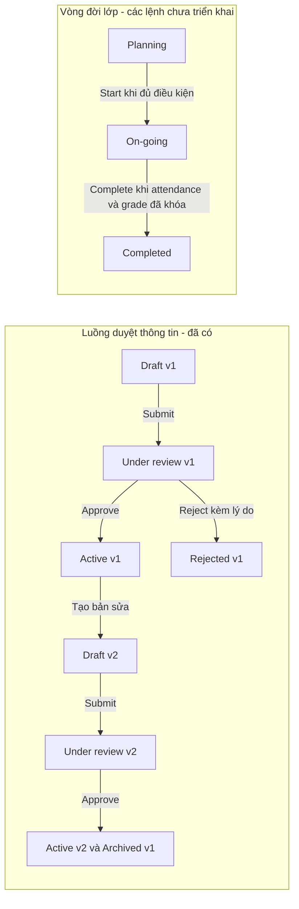

# DEV 1 - Training Class: review và kịch bản demo PM

Ngày review: 21/10/2026. Đối chiếu code hiện tại và SRS v2.0, UFR-PEO-009/010/014/015 (tr.45/46/50/51), BR-UNI-01/02/06/08/09/11 và ma trận trạng thái (tr.119-120).

## 1. Phạm vi và quyền sở hữu trạng thái

Liêm sở hữu thông tin cơ bản của `TrainingClass`, CRUD/query và snapshot `TrainingClassRevision`. `classId` giữ nguyên qua mọi revision. Không sở hữu roster, Calendar Version, session, phân công nguồn lực, attendance hoặc grade; không tạo lại Course/Program.

`TrainingClass.status` thuộc Class. Hướng tích hợp đề xuất: một service chịu trách nhiệm chuyển trạng thái lớp sau khi nhận kết quả kiểm tra từ các module liên quan. Không để Calendar/Roster/Attendance tự cập nhật bảng Class. Người thực hiện Start/Complete/Cancel và dev phụ trách luồng điều phối cần PM phân công; phần CRUD hiện tại chưa triển khai các lệnh này.

| Thuộc tính | Trả lời câu hỏi | Ví dụ |
| --- | --- | --- |
| `TrainingClass.status` | Lớp đang ở giai đoạn nào? | PLANNING / ONGOING / COMPLETED / CANCELLED |
| `TrainingClassRevision.status` | Bộ thông tin này đã được duyệt chưa? | DRAFT / UNDER_REVIEW / ACTIVE / ARCHIVED / REJECTED |
| `TrainingClass.isActive` | Bản ghi lớp có bị deactivate không? | true / false |

Revision ACTIVE có thể thuộc lớp PLANNING. Approve revision không đồng nghĩa Start lớp. ARCHIVED là trạng thái của revision cũ, không phải CANCELLED của lớp. Class Revision và Calendar Version có số phiên bản độc lập.

## 2. Hai luồng độc lập

Cancel thuộc vòng đời lớp nhưng cần chốt thêm trạng thái nguồn được phép Cancel, lý do và hậu quả đến lịch/roster/điểm. Không dùng Deactivate để thay thế Cancel.

Create hiện tạo Class PLANNING + Draft v1, chưa có bản published. Save chỉ lưu Draft; Submit khóa nội dung để review. Approve lần đầu tạo Active v1 nhưng Class vẫn PLANNING. Chỉ lệnh Start riêng mới chuyển thành ONGOING; không tự chuyển theo ngày.

Khi lớp đang ONGOING và dùng Active v1: tạo Draft v2 từ Active, sửa/lưu/gửi duyệt; vận hành vẫn dùng v1. Approve thành công chuyển v2 thành Active và v1 thành Archived trong cùng transaction, không đổi `classId` hoặc lifecycle. Reject giữ nguyên v1, lưu lý do và lần tạo tiếp theo là v3; không dùng lại số v2.

## 3. Các module cần làm việc cùng

| Module sở hữu dữ liệu | Class cần gì? | Dùng lúc nào? | Hiện trạng |
| --- | --- | --- | --- |
| Auth/RBAC và tenant/scope | Actor, permission, phạm vi lớp/tenant được thao tác | Mọi API | Có permission; Class chưa có tenant/object scope |
| Training Program / Program Version | Version tồn tại, ACTIVE, đúng phạm vi; nội dung chương trình không do Class sở hữu | Create và Approve lần đầu | `ProgramVersionChecker`; demo chỉ chấp nhận ID 1, chưa kiểm chứng trạng thái/scope từ module thật |
| Open Class Request | Request APPROVED, program khớp | Create và Approve lần đầu theo policy code hiện tại | `OpenClassRequestChecker`, fixture request 101; chưa adapter thật |
| Roster và phân công tài nguyên | Class Admin active; trainer theo topic; số học viên đang chiếm chỗ theo policy | Start; duyệt giảm capacity hoặc đổi điều kiện vận hành | Chưa nối checker thật |
| Phân Course/Trainer theo Topic | Đủ ánh xạ topic/course/trainer của lớp | Start và thay đổi có ảnh hưởng | Chưa nối checker thật |
| Calendar / Calendar Version / Session | Có lịch active; session hợp lệ trong khoảng ngày, phòng/slot/holiday không xung đột | Start; duyệt đổi ngày/site/location/format | Calendar đã có code riêng, chưa nối với Class revision |
| Site/Location/Room catalog | Location thuộc Site; nếu là phòng thì sức chứa và tình trạng sử dụng do module tài nguyên quyết định | Dropdown và kiểm tra thay đổi địa điểm | Catalog DEV 1 hiện là demo; chọn Location chưa phải đặt phòng |
| Attendance / Grade | Trạng thái khóa dữ liệu theo policy | Complete | Chưa nối; attendance phải kiểm tra lớp ONGOING, không chỉ revision ACTIVE |
| Audit/event chung | Actor, thời gian, before/after, correlation ID; thông báo thay đổi đã publish | Mutation và tích hợp module | Có audit cơ bản/lịch sử revision; chưa đầy đủ audit event/outbox |

Các tên trên là trách nhiệm module theo SRS, không phải tên dev đã được phân công. Repository chưa đủ thông tin để gán DEV 2/3/4 hoặc người cụ thể.

Điểm cần thống nhất sớm với người làm Calendar: `CalendarServiceImpl` và `CalendarRules` đang đọc Class qua `ExternalApiService`, đường dẫn `/api/classes/{id}`; Calendar còn giữ `classStartDate/classEndDate`. Cần dùng cùng nguồn `classId`, chuyển sang contract đọc bản đã publish (hoặc adapter/service tương đương), và thống nhất cập nhật/kiểm tra khoảng ngày khi Class đổi revision. Không chỉ đổi URL rồi coi tích hợp đã xong; còn response, xác thực và tính nhất quán dữ liệu.

API đã có để module khác đọc: `GET /api/classes/{id}/published`, yêu cầu READ. Lớp chưa có bản duyệt hoặc đã deactivate trả 404. Module nhận vẫn phải kiểm tra lifecycle phù hợp nghiệp vụ của mình.

## 4. BR và field đang thực thi

| Field/thao tác | Quy tắc hiện tại |
| --- | --- |
| `code` | Bắt buộc, trim, tối đa 255 ký tự, unique; không đổi sau Create |
| `name` | Bắt buộc, trim, tối đa 255 ký tự; được trùng tên |
| `description` | Tùy chọn, trim, tối đa 2.000 ký tự |
| `openClassRequestId` | Bắt buộc, số dương, request APPROVED và program khớp; không có luồng đổi request sau Create |
| `programVersionId` | Bắt buộc, số dương, đi qua checker; không đổi sau Create |
| `site`, `location` | Bắt buộc, thuộc catalog; Location phải khớp Site; đổi Site xóa Location không phù hợp |
| `traineeType`, `deliveryFormat` | Bắt buộc, thuộc catalog demo |
| `startDate`, `endDate` | Bắt buộc; End Date >= Start Date; hiện không bắt buộc Start Date >= hôm nay |
| Start Date khi ONGOING | Không được đổi; kiểm tra tại Save, Submit và Approve |
| `capacity` | Bắt buộc, JSON integer từ 1 đến 50; không nhận chuỗi, số âm, số thập phân hay số mũ |
| Site/Location/End Date khi ONGOING | Cho đề xuất trong Draft; chỉ áp dụng sau approval và kiểm tra dependency |
| Class COMPLETED/CANCELLED hoặc inactive | Không tạo/sửa/submit/approve/reject revision |
| Under review | Không sửa nội dung; phải Approve hoặc Reject bằng quyền riêng |
| Reject | Bắt buộc lý do; giữ nguyên bản đã publish |
| Deactivate | `isActive=false`, ẩn khỏi list và API published; không xóa lịch sử, không đổi lifecycle thành CANCELLED |

Các chuỗi nhập có giới hạn và bộ đếm ở UI; API kiểm tra độc lập. Capacity và thứ tự ngày còn có constraint DB. Capacity không thay thế việc đếm roster: ví dụ lớp đang có 30 người chiếm chỗ thì giảm còn 25 phải bị checker roster từ chối khi nối tích hợp.

Với lớp đã có bản Active, đổi trainee type, delivery format, Site, Location, ngày hoặc capacity cần `TrainingClassChangeChecker`. Quy tắc này áp dụng cả PLANNING đã publish và ONGOING. Hiện có interface nhưng chưa có implementation thật: Save/Submit được, Approve trả **503**, giữ nguyên Active và bản Under review. Có thể Reject rồi tạo revision mới. Đổi riêng tên/ghi chú không cần checker này.

## 5. Unique và kiểm soát cạnh tranh

| Ràng buộc | Cách bảo vệ hiện tại |
| --- | --- |
| Một mã lớp không bị tạo trùng | Service pre-check + DB `uk_training_class_code`; xung đột trả 409, kể cả concurrent create |
| Không trùng số revision trong cùng lớp | DB unique `(class_id, revision_no)` |
| Tối đa một Draft/Under review mở cho mỗi lớp | Pending pointer + service khóa dòng Class và kiểm tra trạng thái |
| Một bản đang được áp dụng | Current pointer + service archive bản cũ/activate bản mới trong cùng transaction |
| Hai người sửa cùng dữ liệu | `@Version` trên Class và Revision; request gửi `version` và `revisionVersion`; stale trả 409 |
| Không duyệt nhầm bản dựa trên dữ liệu cũ | `baseRevisionId` phải khớp revision đang áp dụng |

Tên lớp, Location, `programVersionId` và `openClassRequestId` không được đặt unique. Nhiều lớp có thể dùng cùng program; code chưa giới hạn một request sinh bao nhiêu lớp. Hai lớp cùng Location không tự động là lỗi trùng phòng: cần Calendar kiểm tra thời gian sử dụng.

Giới hạn phải nói rõ: mã lớp hiện unique **toàn DB**, trong khi SRS yêu cầu **theo tenant**. Chưa có canonicalization/regex riêng hoặc chốt phân biệt hoa/thường; so sánh theo DB hiện tại. Deactivate không giải phóng mã để dùng lại. Ràng buộc một pending/một active hiện do service/pointer bảo vệ, không phải unique constraint theo status.

## 6. Phân quyền

| Permission | Thao tác |
| --- | --- |
| `TRAINING_CLASS_READ` | List/detail/published |
| `TRAINING_CLASS_CREATE` | Tạo lớp Draft v1 |
| `TRAINING_CLASS_UPDATE` | Tạo revision kế tiếp và Save Draft |
| `TRAINING_CLASS_SUBMIT` | Gửi duyệt |
| `TRAINING_CLASS_APPROVE` | Approve/Reject |
| `TRAINING_CLASS_DELETE` | Deactivate |

Quyền kiểm tra ở backend và UI. Xem lịch sử/snapshot chưa duyệt cần READ và thêm một trong CREATE/UPDATE/SUBMIT/APPROVE. Người chỉ READ không thấy lớp chưa từng duyệt. Có APPROVE thì được tự duyệt theo lựa chọn demo đã chốt, nhưng không tự có các quyền CREATE/UPDATE/SUBMIT nếu chưa được cấp.

Chưa có permission/action Start/Complete/Cancel trong module này. Không trình bày DELETE là Cancel hoặc APPROVE là Start. Tenant/object scope còn thiếu nên không tuyên bố đã hoàn tất mô hình phân quyền SRS.

## 7. Kịch bản demo 10-15 phút

1. Chạy backend profile `dev1-demo`, frontend và đăng nhập tài khoản có READ/CREATE/UPDATE/SUBMIT/APPROVE/DELETE. Request 101 / program 1 là fixture. Backend có lớp mẫu PLANNING/ONGOING/COMPLETED/CANCELLED/inactive và Draft/Under review.
2. List: tìm mã/tên, lọc trạng thái/Site, mở Class Info bằng Class Code.
3. Create với mã mới, request APPROVED, chọn Site/Location, ngày và capacity 25. Save Draft v1. Chỉ ra Class PLANNING, revision DRAFT, chưa có published. Có thể dùng lớp Draft mẫu nếu cần tiết kiệm thời gian.
4. Submit rồi Approve trên cùng tài khoản. Chỉ ra revision ACTIVE v1 nhưng Class vẫn PLANNING. Không có Start trong phạm vi hiện tại.
5. Mở `DEV1-JAVA-ONGOING`: Create Draft v2, chỉ sửa tên/ghi chú, Save. So sánh: Class Info và `/published` vẫn dùng v1. Submit/Approve: v2 ACTIVE, v1 ARCHIVED; `classId` và ONGOING không đổi.
6. Tạo bản tiếp theo, Submit rồi Reject kèm lý do. Bản Active không đổi; lần tạo sau tăng tiếp số revision. Thử bỏ trống lý do để thấy validation.
7. Demo field: mã/tên quá 255, notes quá 2.000 bị chặn; capacity 50 hợp lệ, 51/1000/chữ/số lẻ bị chặn; đổi Site xóa Location; On-going khóa Start Date; Completed/Cancelled không sửa được. API vẫn từ chối khi gửi dữ liệu sai trực tiếp.
8. Demo dependency bằng bản khác: đổi Site/Location/End Date, Save/Submit được; Approve nhận 503 vì thiếu checker. Giải thích đây là giới hạn tích hợp hiện tại, bản Active được giữ nguyên. Không hứa luồng thay đổi này đã chạy xuyên suốt; Reject để đóng đề xuất nếu cần.
9. Demo unique bằng cách Create lại mã đã có: 409, không có lớp thứ hai. Tên lớp trùng được phép.
10. Demo cạnh tranh bằng hai tab cùng phiên bản: tab A Save; tab B Save từ phiên bản cũ nhận 409. Dữ liệu đang nhập được giữ; chỉ Reload latest khi chủ động chọn.
11. Nếu cần demo permission, dùng tài khoản role có READ nhưng không có UPDATE/APPROVE; không sửa quyền của tài khoản đang dùng trước phần demo chính. Demo cuối Deactivate một lớp thử: ẩn khỏi list, lịch sử vẫn còn; đây không phải Cancel.

## 8. Các file mở khi PM hỏi code

| File | Điểm giải thích |
| --- | --- |
| `TrainingClass.java` | Entity Class, lifecycle, current/pending pointer, version, unique code, check ngày/capacity |
| `TrainingClassRevision.java` | Snapshot, revisionNo, status, base revision, audit review, unique theo lớp |
| `service/TrainingClassServiceImpl.java` | Quyền, Create/Save/Submit/Approve/Reject, transaction, locking, kiểm tra dependency |
| `TrainingClassRepository.java` | Khóa dòng và query search/filter; ẩn unpublished với reader |
| `dto/CreateTrainingClassRequest.java`, `dto/UpdateTrainingClassRequest.java` | Field bắt buộc, độ dài, capacity và version |
| `TrainingClassExceptionHandler.java` | Duplicate/stale 409 và lỗi capacity |
| `TrainingClassChangeChecker.java` | Ranh giới nối Calendar/Roster/Resource |
| `ProgramVersionChecker.java`, `OpenClassRequestChecker.java` | Ranh giới nối chương trình/request; mock giới hạn profile demo |
| `TrainingClassCreateForm.tsx`, `TrainingClassEditForm.tsx`, `TrainingClassRevisionPanel.tsx` | Draft, field khóa/mở, so sánh revision, duyệt và conflict |

Java: `backend/src/main/java/com/example/starter_project_2025/system/schedule/trainingclass/`. Frontend: `frontend/src/pages/management/trainingclass/`.

Kết quả kiểm tra gần nhất: 51 test Training Class qua (48 integration + 3 unit), frontend build qua và smoke Edge với backend JWT/H2 thật qua. Đây không phải tuyên bố full suite xanh: lần chạy rộng trước đó còn 7 lỗi context `ModuleGroupControllerTest` thiếu `RefreshTokenService`; ESLint còn thiếu package `typescript-eslint`. Review này không thay đổi production code nên không chạy lại các test đã qua.

## 9. Những điểm cần PM chốt khi chia việc tích hợp

- Ai sở hữu orchestration Start/Complete/Cancel và quyền của từng hành động? Class service nên là nơi đổi lifecycle; các module cung cấp validation.
- Bắt buộc tạo từ request APPROVED hay cho tạo trực tiếp? Một request có thể sinh bao nhiêu lớp? Đây là policy code hiện tại, chưa đủ căn cứ coi là yêu cầu bắt buộc cho mọi lớp trong SRS.
- Contract checker: số học viên chiếm chỗ tính theo trạng thái nào; đổi địa điểm/ngày tác động session tương lai ra sao; giao dịch/phiên bản dữ liệu để tránh thay đổi giữa lúc kiểm tra và lúc publish.
- Có cho Start khi đang có Draft/Under review không; xử lý revision mở khi Complete/Cancel như thế nào? Chưa triển khai hoặc tự chốt ngầm.
- Tenant/object scope, unique theo tenant, chính sách hoa/thường và dùng lại mã; migration dữ liệu/lớp cũ và capacity vượt 50.
- Location là địa điểm tổng quát hay phòng cụ thể; nguồn catalog thật và kiểm tra room capacity/booking do ai phụ trách?
- Contract lỗi: code hiện dùng 400 cho nhiều validation, SRS nêu 422 cho nghiệp vụ. Thống nhất cùng team trước khi đổi.
- Audit before/after/correlation, event/outbox và import/export thuộc sprint nào? Chưa tính hoàn thành trong DEV 1 hiện tại.

Thông điệp demo: DEV 1 đã có CRUD thông tin lớp với Draft/approval, unique, validation, quyền riêng và chống ghi đè. Approve công bố thông tin; Start mở lớp. Lifecycle và thay đổi ảnh hưởng vận hành cần contract với các module liên quan trước khi chạy đầy đủ.

Approval revision và giới hạn capacity 50 là quyết định thiết kế theo review leader/người dùng, không phải toàn bộ yêu cầu nguyên văn của SRS. Chi tiết triển khai: [training-class-dev1.md](training-class-dev1.md); phân tích SRS ban đầu: [training-class-srs-review.md](training-class-srs-review.md).
